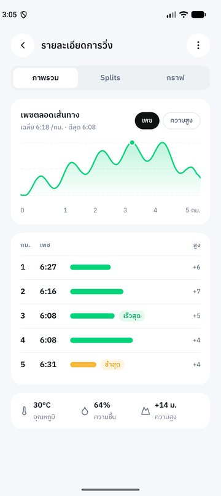
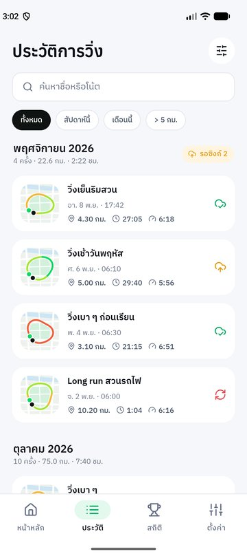
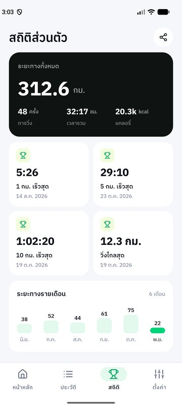
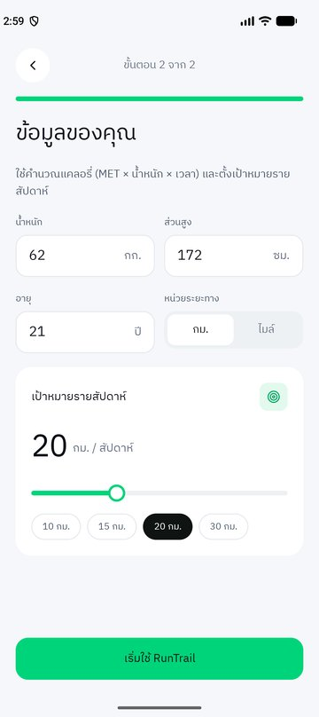
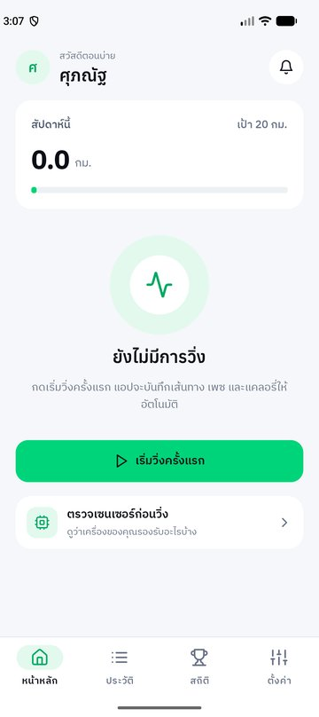
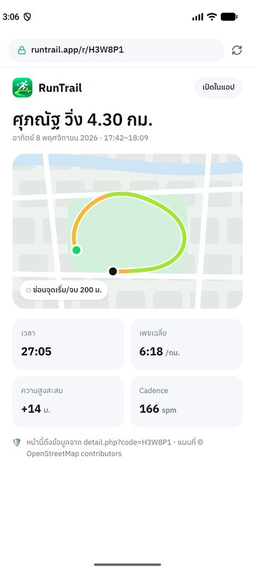
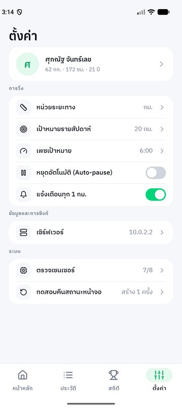
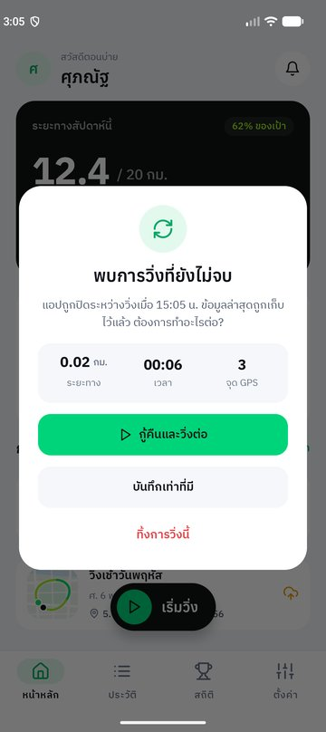

<div align="center">


# RunTrail

**แอปบันทึกการวิ่งด้วย GPS พร้อมแผนที่เส้นทาง เพซ แคลอรี่ และเว็บแชร์เส้นทาง**<br/>
*GPS Run Tracker with Route Map, Pace, Calories & Web Sharing*


-7EBC6F)

โครงงานรายวิชา **CS364 Mobile Application Development**<br/>
ผู้จัดทำ: **ศุภณัฐ จันทร์เลข** · รหัสนักศึกษา 6709616897

</div>

---

## สารบัญ

- [ภาพรวม](#ภาพรวม)
- [ภาพหน้าจอ](#ภาพหน้าจอ)
- [ฟีเจอร์](#ฟีเจอร์)
- [เทคโนโลยีที่ใช้](#เทคโนโลยีที่ใช้)
- [การนำเนื้อหา MA09–MA12 มาใช้](#การนำเนื้อหา-ma09ma12-มาใช้)
- [โครงสร้างโปรเจค](#โครงสร้างโปรเจค)
- [หน้าจอทั้งหมด (19 หน้าจาก Figma)](#หน้าจอทั้งหมด-19-หน้าจาก-figma)
- [สูตรคำนวณ](#สูตรคำนวณ)
- [ระบบออกแบบ (Design System)](#ระบบออกแบบ-design-system)
- [วิธีติดตั้งและรัน](#วิธีติดตั้งและรัน)
- [ทดสอบ GPS บน Emulator](#ทดสอบ-gps-บน-emulator)
- [สิทธิ์ที่แอปขอ](#สิทธิ์ที่แอปขอ)
- [สถานะปัจจุบันและแผนงานถัดไป](#สถานะปัจจุบันและแผนงานถัดไป)
- [เครดิตและสัญญาอนุญาต](#เครดิตและสัญญาอนุญาต)

---

## ภาพรวม

นักวิ่งทั่วไปอยากรู้ว่า *"วิ่งไปทางไหน ช่วงไหนเร็วหรือช้า เผาผลาญไปเท่าไร"* และอยากส่งเส้นทางให้เพื่อนดู
แต่แอปที่มีอยู่มักบังคับสมัครบัญชีและเก็บตำแหน่งไว้บนระบบของผู้ให้บริการ

**RunTrail** จึงออกแบบแบบ **offline-first**:

- 📍 บันทึกเส้นทางจาก **GPS จริง** ลงบนแผนที่ OpenStreetMap ระหว่างวิ่ง
- 🎨 เส้นทาง **ไล่สีตามเพซ** (เขียว → เหลือง → ส้มแดง) เห็นทันทีว่าช่วงไหนเร็วหรือช้า
- 📊 Split รายกิโลเมตร กราฟเพซและความสูง สถิติดีที่สุด และ **Replay** การวิ่งย้อนหลัง
- 🔒 ข้อมูลอยู่ในเครื่อง ใช้ได้แม้ไม่มีอินเทอร์เน็ต และจะซิงก์ขึ้นเซิร์ฟเวอร์ **เฉพาะเมื่อกดแชร์**
- 🌐 เพื่อนเปิดลิงก์ดูแผนที่และสถิติผ่านเว็บได้โดยไม่ต้องติดตั้งแอป

---

## ภาพหน้าจอ

| Welcome | หน้าหลัก | วิ่งสด (GPS จริง) | สรุปผล |
|:---:|:---:|:---:|:---:|
|  |  |  |  |

| Replay | Splits & กราฟ | ประวัติ | สถิติส่วนตัว |
|:---:|:---:|:---:|:---:|
|  |  |  |  |

<details>
<summary><b>ดูหน้าจออื่น ๆ ทั้งหมด</b></summary>

| ขอสิทธิ์ | โปรไฟล์และเป้าหมาย | หน้าหลัก (ผู้ใช้ใหม่) | หยุดชั่วคราว |
|:---:|:---:|:---:|:---:|
|  |  |  |  |

| แก้ไขการวิ่ง | หน้าเว็บแชร์ | ตั้งค่า | ตัวเลือก (Bottom sheet) |
|:---:|:---:|:---:|:---:|
|  |  |  |  |

| กู้การวิ่งที่ค้าง | ยืนยันการลบ |
|:---:|:---:|
|  |  |

</details>

> ภาพหน้าจอเหล่านี้ถ่ายจาก Android Emulator (Pixel 9) โดยป้อนพิกัด GPS จำลองรอบสวนลุมพินี กรุงเทพฯ

---

## ฟีเจอร์

### 🏃 บันทึกการวิ่ง
- อ่านตำแหน่งจาก `LocationManager` ทุก 1 วินาที แล้ว **กรองจุดคลาดเคลื่อน** (ความแม่นยำแย่กว่า 25 ม. / เร็วเกิน 9 ม./วินาที / ขยับน้อยกว่าค่าคลาดเคลื่อน)
- แสดงระยะทาง เวลา **เพซปัจจุบัน** (เฉลี่ย 30 วินาทีล่าสุด) เพซเฉลี่ย แคลอรี่ Cadence ความสูงสะสม และแบตเตอรี่
- แผนที่ OpenStreetMap เลื่อนตามตำแหน่งนักวิ่ง เส้นทางไล่สีตามเพซ มีปุ่มกลับไปตำแหน่งปัจจุบันและสลับแผนที่โหมดมืด
- ป้ายสถานะ GPS: กำลังหาสัญญาณ · ดี · พอใช้ · อ่อน · GPS ปิด · ยังไม่อนุญาต (แตะเพื่อแก้ไขได้ทันที)
- ป้ายเทียบ **เพซเป้าหมาย** เช่น "เร็วกว่าเป้า 12 วิ/กม."
- เข็มทิศจาก rotation vector (สำรองด้วย magnetometer + accelerometer)
- **Auto-pause** เมื่อไม่ขยับเกิน 8 วินาที และวิ่งต่อเองเมื่อเริ่มเคลื่อนที่
- **กดค้าง 1.5 วินาทีเพื่อจบ** กันกดพลาด · ปุ่มล็อกหน้าจอ · ถ่ายรูปแนบกับการวิ่ง
- **กู้การวิ่งที่ค้าง**: เขียนสถานะ + จุด GPS ลงไฟล์ทุก 5 วินาที ถ้าแอปถูกปิดกลางคันจะถามว่าจะกู้คืน บันทึกเท่าที่มี หรือทิ้ง

### 📈 วิเคราะห์ผล
- สรุปผลหลังวิ่ง: ระยะ เวลาเคลื่อนที่ เพซ แคลอรี่ ความสูงสะสม Cadence ป้าย "สถิติใหม่" และสถานะซิงก์
- **Splits** รายกิโลเมตร พร้อมแถบเทียบและป้าย *เร็วสุด / ช้าสุด*
- กราฟเพซและความสูงตลอดเส้นทาง (วาดด้วย Canvas)
- **Replay** เล่นย้อนการวิ่งบนแผนที่ เลื่อนไทม์ไลน์ได้ ปรับความเร็ว 1× / 2× / 4× / 8×
- **สถิติส่วนตัว**: ระยะ/เวลา/แคลอรี่รวม · 1 / 5 / 10 กม. เร็วสุด · วิ่งไกลสุด · กราฟรายเดือน 6 เดือน

### 🗂 จัดการข้อมูล
- ประวัติการวิ่งแบบ RecyclerView จัดกลุ่มรายเดือน · ค้นหาชื่อ/โน้ต · กรอง (ทั้งหมด / 7 วัน / เดือนนี้ / > 5 กม.) · เรียงลำดับ
- เพิ่มการวิ่งย้อนหลัง / แก้ไขชื่อ โน้ต วันเวลา และรูป (กล้องหรือแกลเลอรี · แก้ทิศตาม EXIF · ย่อ · JPEG 80%)
- กดค้างที่การ์ดเพื่อลบ (เลือกลบจากเซิร์ฟเวอร์ด้วยได้)

### 🔗 แชร์
- คัดลอกลิงก์ · ส่งต่อไปแอปอื่น · **QR Code** (สร้างในเครื่องด้วย ZXing) · ดูตัวอย่างหน้าเว็บ
- ตัวเลือกความเป็นส่วนตัว: **ซ่อน 200 ม. แรกและสุดท้าย** (ไม่เปิดเผยตำแหน่งบ้าน) · แสดงรูป · แสดงแคลอรี่

### ⚙️ ตั้งค่าและอื่น ๆ
- Onboarding 3 ขั้น: แนะนำแอป → อธิบายเหตุผลก่อนขอสิทธิ์ → โปรไฟล์ (ชื่อ นามสกุล น้ำหนัก ส่วนสูง อายุ หน่วย) และเป้าหมายรายสัปดาห์
- หน่วย กม./ไมล์ · เป้าหมายรายสัปดาห์ · เพซเป้าหมาย · Auto-pause · แจ้งเตือนทุก 1 กม. · ที่อยู่เซิร์ฟเวอร์
- **ตรวจเซนเซอร์**: เครื่องมี/ไม่มีเซนเซอร์อะไร พร้อมค่าสด และแจ้งให้ปรับเทียบเข็มทิศเมื่อความแม่นยำต่ำ
- ทดสอบการคืนสถานะหน้าจอ (`recreate()` + นับจำนวนครั้งผ่าน `onSaveInstanceState`)

---

## เทคโนโลยีที่ใช้

| ส่วน | ที่เลือกใช้ |
|---|---|
| ภาษา | **Kotlin** (ไม่มีไฟล์ `.java`) |
| UI | XML Layout + **ViewBinding** + Material Components (Material3) |
| Build | Gradle Kotlin DSL · Version Catalog (`gradle/libs.versions.toml`) · AGP 9.3.3 |
| SDK | `compileSdk 37` · `minSdk 28` · `targetSdk 37` · Java 11 |
| แผนที่ | [osmdroid](https://github.com/osmdroid/osmdroid) 6.1.20 (OpenStreetMap) |
| ตำแหน่ง | `android.location.LocationManager` (GPS provider) |
| เซนเซอร์ | `SensorManager` — Step Counter, Rotation Vector, Magnetometer, Accelerometer, Barometer, Light, Ambient Temperature |
| รายการ | `RecyclerView` |
| รูปภาพ | `ExifInterface` (แก้ทิศภาพ) · Activity Result API (กล้อง / แกลเลอรี) |
| QR Code | [ZXing core](https://github.com/zxing/zxing) 3.5.3 |
| กราฟ | Custom `View` วาดด้วย `Canvas` (ไม่ใช้ไลบรารีกราฟ) |
| ฟอนต์ | Anuphan (หัวข้อ/ตัวเลข) · IBM Plex Sans Thai (เนื้อหา) |
| ไอคอน | Lucide (แปลงเป็น VectorDrawable) |

---

## การนำเนื้อหา MA09–MA12 มาใช้

| บทเรียน | ใช้ในโปรเจค |
|---|---|
| **MA09** ข้อมูลภายในเครื่อง + คืนสถานะ | `SharedPreferences` เก็บโปรไฟล์และค่าตั้งค่า (`PrefsHelper`) · ไฟล์ `.properties` + CSV เก็บการวิ่งที่ค้าง (`DraftStore`) · `onSaveInstanceState` ในหน้าวิ่ง โปรไฟล์ Replay ประวัติ ตั้งค่า |
| **MA10** SQLite + RecyclerView + รูปภาพ | `RecyclerView` + `RunAdapter` (2 view type) · CRUD ผ่าน `RunRepository` (ชื่อเมธอดตรงกับ DBHelper) · รูปจากกล้อง/แกลเลอรี แก้ EXIF ย่อ และบีบอัด (`ImageStore`) |
| **MA11** ฐานข้อมูลออนไลน์ | `net/ApiConfig` · หน้าแชร์/ซิงก์/ลบออนไลน์ และหน้าเว็บแชร์ (ส่วนติดต่อเซิร์ฟเวอร์จริงอยู่ในแผนถัดไป) |
| **MA12** เซนเซอร์ | GPS จริง (`LocationTracker`) · Cadence จาก Step Counter (`CadenceTracker`) · เข็มทิศ (`CompassHelper`) · ตรวจเซนเซอร์ register ใน `onResume` / unregister ใน `onPause` · `<uses-feature required="false">` |

---

## โครงสร้างโปรเจค

```
app/src/main/
├── AndroidManifest.xml
├── java/com/example/runtrail/
│   ├── data/                    # โมเดลและแหล่งข้อมูล
│   │   ├── Run.kt               #   Run · TrackPoint · Split · RoutePoint · SyncStatus
│   │   ├── RunRepository.kt     #   CRUD + ค้นหา/กรอง/เรียง + สถิติรายสัปดาห์/เดือน
│   │   ├── SampleData.kt        #   ข้อมูลตัวอย่าง (อิงวันที่ปัจจุบัน)
│   │   ├── PrefsHelper.kt       #   SharedPreferences (MA09)
│   │   └── DraftStore.kt        #   การวิ่งที่ค้าง → .properties + CSV (MA09)
│   ├── domain/                  # ตรรกะล้วน ไม่ผูก Android (ทดสอบบน JVM ได้)
│   │   ├── TrackMath.kt         #   Haversine · splits · ความสูงสะสม · GpsFilter
│   │   ├── RunCalculator.kt     #   เพซ · แคลอรี่ (ACSM/MET) · สถิติดีที่สุด
│   │   ├── RouteGenerator.kt    #   เส้นทางสำหรับวาด (จาก GPS จริง หรือจำลองสำหรับข้อมูลตัวอย่าง)
│   │   ├── PaceColor.kt         #   สีตามระดับเพซ
│   │   └── Fmt.kt               #   รูปแบบตัวเลข/เวลา/วันที่ภาษาไทย
│   ├── sensor/                  # เซนเซอร์และตำแหน่ง (MA12)
│   │   ├── LocationTracker.kt   #   GPS ทุก 1 วินาที
│   │   ├── CadenceTracker.kt    #   ก้าว/นาที จาก Step Counter
│   │   ├── CompassHelper.kt     #   เข็มทิศ
│   │   └── SensorHelper.kt      #   รายการเซนเซอร์ + ตรวจว่ามีในเครื่องไหม
│   ├── net/
│   │   └── ApiConfig.kt         #   ที่อยู่เซิร์ฟเวอร์ (MA11)
│   └── ui/                      # หน้าจอ แยกตามฟีเจอร์
│       ├── onboarding/          #   Welcome · Permissions · ProfileSetup
│       ├── home/                #   MainActivity (หน้าหลัก)
│       ├── live/                #   LiveRunActivity (วิ่งสด)
│       ├── detail/              #   RunDetailActivity · RunStatsActivity
│       ├── replay/              #   ReplayActivity
│       ├── edit/                #   AddEditRunActivity
│       ├── share/               #   ShareSheet · WebPreviewActivity
│       ├── history/             #   HistoryActivity · RunAdapter
│       ├── records/             #   RecordsActivity
│       ├── settings/            #   SettingsActivity
│       ├── sensor/              #   SensorCheckActivity
│       ├── common/              #   BottomNav · Dialogs · Sheets · RunCardBinder · ImageStore · Screen
│       └── widget/              #   Custom View: MapRouteView · OsmRoute · BarChartView ·
│                                #   LineChartView · RingProgressView · HoldToStopView · ToggleSwitch
└── res/
    ├── layout/                  # activity_* · item_* · view_* · dialog_* · sheet_*
    ├── drawable/                # ไอคอน Lucide (VectorDrawable) + shape ทั้งหมด
    ├── font/                    # Anuphan · IBM Plex Sans Thai
    ├── values/                  # colors · strings (ภาษาไทยทั้งหมด) · themes · styles_text · styles_components
    ├── color/                   # ColorStateList ของชิป แท็บ ตัวเลือก
    └── menu/                    # bottom_nav
```

**หลักการ:** `domain/` เป็น Kotlin ล้วนไม่ผูก Android · หน้าจอ 1 หน้า = 1 Activity ตามแบบในคาบเรียน · แท็บล่าง 4 แท็บเป็น Activity แยกที่สลับกันโดยไม่มีแอนิเมชัน

---

## หน้าจอทั้งหมด (19 หน้าจาก Figma)

| # | หน้าจอ | Activity / Component |
|---|---|---|
| 01 | Welcome | `ui/onboarding/WelcomeActivity` |
| 02 | ขอสิทธิ์การใช้งาน | `ui/onboarding/PermissionsActivity` |
| 03 | โปรไฟล์และเป้าหมาย | `ui/onboarding/ProfileSetupActivity` (ใช้เป็นหน้าแก้ไขโปรไฟล์ด้วย) |
| 04 | ตรวจเซนเซอร์ | `ui/sensor/SensorCheckActivity` |
| 05 | หน้าหลัก — สถานะว่าง | `ui/home/MainActivity` (เมื่อยังไม่มีการวิ่ง) |
| 06 | หน้าหลัก | `ui/home/MainActivity` |
| 07 | บันทึกการวิ่งสด | `ui/live/LiveRunActivity` |
| 08 | หยุดชั่วคราว / กดค้างเพื่อจบ | `ui/live/LiveRunActivity` + `HoldToStopView` |
| 09 | สรุปผลการวิ่ง | `ui/detail/RunDetailActivity` |
| 10 | Splits และกราฟ | `ui/detail/RunStatsActivity` |
| 11 | Replay | `ui/replay/ReplayActivity` |
| 12 | เพิ่ม / แก้ไขการวิ่ง | `ui/edit/AddEditRunActivity` |
| 13 | แชร์และซิงก์ | `ui/share/ShareSheet` (Bottom sheet) |
| 14 | หน้าเว็บแชร์เส้นทาง | `ui/share/WebPreviewActivity` (WebView) |
| 15 | ประวัติการวิ่ง | `ui/history/HistoryActivity` |
| 16 | สถิติส่วนตัว | `ui/records/RecordsActivity` |
| 17 | ตั้งค่า | `ui/settings/SettingsActivity` |
| 18 | กู้การวิ่งที่ค้าง | `ui/common/Dialogs.recoverRun` |
| 19 | ยืนยันการลบ | `ui/common/Dialogs.confirmDelete` |

---

## สูตรคำนวณ

| ค่า | สูตร |
|---|---|
| ระยะทางระหว่าง 2 จุด | Haversine: `d = 2R·asin(√(sin²(Δφ/2) + cosφ₁·cosφ₂·sin²(Δλ/2)))`, R = 6,371 กม. |
| เพซ (วินาที/กม.) | `เวลาเคลื่อนที่ ÷ (ระยะทาง ÷ 1000)` |
| เพซปัจจุบัน | ระยะและเวลาของจุด GPS ใน 30 วินาทีล่าสุด |
| แคลอรี่ | `MET × น้ำหนัก(กก.) × ชั่วโมง` โดย `MET = (0.2 × ความเร็ว(ม./นาที) + 3.5) ÷ 3.5` (ACSM) |
| Split | ประมาณเวลาที่ผ่านแต่ละหลักกิโลเมตรแบบเชิงเส้นระหว่างจุด GPS |
| ความสูงสะสม | รวมเฉพาะช่วงขึ้น ตัดการแกว่งที่น้อยกว่า 2 ม. |
| Cadence | จำนวนก้าวที่เพิ่มขึ้นใน 30 วินาทีล่าสุด ÷ เวลาเป็นนาที (ก้าว/นาที) |
| สีตามเพซ | เร็ว < 5:50 · คงที่ ≤ 6:15 · ปานกลาง ≤ 6:40 · ช้ากว่านั้น |

---

## ระบบออกแบบ (Design System)

ออกแบบใน Figma โทน **ขาว · เขียว · เทา · ดำ**

| โทเคน | สี | ใช้กับ |
|---|---|---|
| Green | `#00D47A` | ปุ่มหลัก · เส้นทาง · สถานะสำเร็จ |
| Lime | `#A3F51F` | ไฮไลต์บนพื้นดำ · วงแหวนกดค้างเพื่อจบ |
| Ink | `#0F1412` | การ์ดสรุป · ปุ่มเริ่มวิ่ง · ชิปที่เลือก |
| White | `#FFFFFF` | การ์ด · Bottom sheet |
| Canvas | `#F5F7FA` | พื้นหลังหน้าจอ · ไทล์ |
| Gray | `#667085` | ข้อความรอง |

**Pace scale:** `#0EDA62` → `#A3E635` → `#F5B83D` → `#F0603F`

Text styles อยู่ใน `res/values/styles_text.xml` (Display · H1 · H2 · H3 · NumL · NumM · LabelL · Body · Caption · Overline)
และ component styles อยู่ใน `res/values/styles_components.xml` (ปุ่ม · IconChip · ChipToggle · Segment · Field · Toggle · BottomNav)

---

## วิธีติดตั้งและรัน

**สิ่งที่ต้องมี**
- Android Studio รุ่นที่รองรับ AGP 9.3.3
- Android SDK 37
- อุปกรณ์หรือ Emulator ที่เป็น Android 9 (API 28) ขึ้นไป

**ขั้นตอน**
```bash
git clone https://github.com/suphanatchanlek30/POC-RunTrail.git
```
1. เปิดโฟลเดอร์โปรเจคใน Android Studio แล้วรอ Gradle sync
2. เลือกอุปกรณ์แล้วกด **Run ▶**

หรือ build ผ่าน command line:
```bash
./gradlew assembleDebug
# ไฟล์ APK: app/build/outputs/apk/debug/app-debug.apk
```

> 💡 ทดสอบเซนเซอร์และ GPS บน **เครื่องจริง** จะได้ผลดีที่สุด (Emulator ไม่มี Step Counter และเซนเซอร์บางตัว)

---

## ทดสอบ GPS บน Emulator

**วิธีที่ 1 — Extended Controls**
เปิด Emulator → `⋯` → **Location** → แท็บ **Routes** → วาดเส้นทางหรือโหลดไฟล์ GPX → **Play route**

**วิธีที่ 2 — คำสั่ง adb** (ป้อนพิกัดทีละจุด รูปแบบ `ลองจิจูด ละติจูด ความสูง`)
```bash
adb emu geo fix 100.5385 13.7290 5
adb emu geo fix 100.5386 13.7293 5
# ...ป้อนต่อเนื่องทุก 1 วินาที เพื่อจำลองการวิ่ง
```

---

## สิทธิ์ที่แอปขอ

| สิทธิ์ | เหตุผล |
|---|---|
| `ACCESS_FINE_LOCATION` / `ACCESS_COARSE_LOCATION` | บันทึกเส้นทางและคำนวณระยะทาง (จำเป็น) |
| `ACTIVITY_RECOGNITION` | อ่าน Step Counter เพื่อคำนวณ Cadence |
| `POST_NOTIFICATIONS` | แจ้งเพซทุก 1 กม. |
| `INTERNET` / `ACCESS_NETWORK_STATE` | โหลดภาพแผนที่ OpenStreetMap |

ทุกเซนเซอร์ประกาศเป็น `required="false"` เครื่องที่ไม่มีเซนเซอร์บางตัวยังติดตั้งได้ และแอปจะใช้ค่าทดแทน

---

## สถานะปัจจุบันและแผนงานถัดไป

**ทำแล้ว**
- [x] UI ครบ 19 หน้าตาม Figma ใช้งานได้จริงทุกปุ่ม
- [x] บันทึกเส้นทางจาก GPS จริงบนแผนที่ OpenStreetMap
- [x] Splits · กราฟ · Replay · สถิติดีที่สุด คำนวณจากข้อมูลจริง
- [x] โปรไฟล์ ตั้งค่า และการวิ่งที่ค้าง บันทึกถาวรในเครื่อง

**ข้อจำกัดตอนนี้**
- ⚠️ รายการการวิ่งยังเก็บใน **หน่วยความจำ** — ปิดแอปแล้วการวิ่งที่บันทึกจะหาย (มีข้อมูลตัวอย่างโหลดใหม่ทุกครั้ง)
- ⚠️ ต้อง **เปิดหน้าจอค้างไว้** ระหว่างวิ่ง (แอปตั้งให้จอไม่ดับอัตโนมัติ) เพราะยังไม่มี foreground service
- ⚠️ ปุ่ม "ซิงก์ตอนนี้" และรหัสแชร์ยังเป็นตัวจำลอง ยังไม่ส่งข้อมูลขึ้นเซิร์ฟเวอร์จริง
- ข้อมูลตัวอย่างไม่มีพิกัดจริง จึงแสดงบนแผนที่จำลอง

**แผนถัดไป**
- [ ] เก็บข้อมูลลง **SQLite** (`runs` · `run_points` · `splits`) ตาม MA10
- [ ] Foreground service สำหรับบันทึกตำแหน่งขณะปิดหน้าจอ
- [ ] ฝั่งเซิร์ฟเวอร์ PHP + MySQL (`create.php` · `list.php` · `detail.php` · `update.php` · `delete.php`) และเชื่อมด้วย Volley ตาม MA11
- [ ] หน้าเว็บ `view.php?code=…` ด้วย Leaflet
- [ ] แจ้งเตือนเพซทุก 1 กม. และโหมดแผนที่กลางคืนอัตโนมัติจาก Light sensor
- [ ] Unit test สำหรับ `domain/` (TrackMath · RunCalculator)

---

## เครดิตและสัญญาอนุญาต

| ทรัพยากร | สัญญาอนุญาต |
|---|---|
| ข้อมูลแผนที่ © [OpenStreetMap contributors](https://www.openstreetmap.org/copyright) | ODbL |
| [osmdroid](https://github.com/osmdroid/osmdroid) | Apache License 2.0 |
| [ZXing](https://github.com/zxing/zxing) | Apache License 2.0 |
| ฟอนต์ [Anuphan](https://fonts.google.com/specimen/Anuphan) · [IBM Plex Sans Thai](https://fonts.google.com/specimen/IBM+Plex+Sans+Thai) | SIL Open Font License 1.1 |
| ไอคอน [Lucide](https://lucide.dev) | ISC License |
| AndroidX · Material Components | Apache License 2.0 |

> การใช้ภาพแผนที่จากเซิร์ฟเวอร์ของ OpenStreetMap เป็นไปตาม [Tile Usage Policy](https://operations.osmfoundation.org/policies/tiles/) — เหมาะกับการทดสอบและสาธิตงาน ถ้าจะเผยแพร่ให้ผู้ใช้จำนวนมากควรใช้ผู้ให้บริการแผนที่ของตัวเอง

---

<div align="center">

พัฒนาเพื่อการศึกษา · CS364 Mobile Application Development<br/>
**ศุภณัฐ จันทร์เลข** · 6709616897

</div>
