<div align="center">


# RunTrail

**แอปบันทึกการวิ่งด้วย GPS · ใช้ได้แม้ไม่มีเน็ต · ซิงก์ขึ้นเซิร์ฟเวอร์ · แชร์เส้นทาง · แข่งอันดับโลก**<br/>
*Offline-first GPS run tracker for Android with a Go backend*


โครงงานรายวิชา **CS364 Mobile Application Development**<br/>
ผู้จัดทำ: **ศุภณัฐ จันทร์เลข** · รหัสนักศึกษา 6709616897

</div>

---

## สารบัญ

1. [ภาพรวม](#ภาพรวม)
2. [ภาพหน้าจอ](#ภาพหน้าจอ)
3. [ฟีเจอร์](#ฟีเจอร์)
4. [สถาปัตยกรรม](#สถาปัตยกรรม)
5. [เทคโนโลยีที่ใช้](#เทคโนโลยีที่ใช้)
6. [โครงสร้างโปรเจค](#โครงสร้างโปรเจค)
7. [เริ่มต้นใช้งาน](#เริ่มต้นใช้งาน)
8. [ทดสอบด้วย GPS](#ทดสอบด้วย-gps)
9. [การทดสอบอัตโนมัติ (Test)](#การทดสอบอัตโนมัติ-test)
10. [API โดยสรุป](#api-โดยสรุป)
11. [สูตรคำนวณและการตรวจการวิ่ง](#สูตรคำนวณและการตรวจการวิ่ง)
12. [ความเป็นส่วนตัวและความปลอดภัย](#ความเป็นส่วนตัวและความปลอดภัย)
13. [สิทธิ์ที่แอปขอ](#สิทธิ์ที่แอปขอ)
14. [การนำเนื้อหา MA09–MA12 มาใช้](#การนำเนื้อหา-ma09ma12-มาใช้)
15. [ระบบออกแบบ (Design System)](#ระบบออกแบบ-design-system)
16. [ข้อจำกัดและแผนถัดไป](#ข้อจำกัดและแผนถัดไป)
17. [เอกสารเพิ่มเติม](#เอกสารเพิ่มเติม)
18. [เครดิตและสัญญาอนุญาต](#เครดิตและสัญญาอนุญาต)

---

## ภาพรวม

นักวิ่งอยากรู้ว่า *"วิ่งไปทางไหน ช่วงไหนเร็วหรือช้า เผาผลาญไปเท่าไร"* อยากเก็บประวัติไว้ไม่หาย และอยากแชร์ให้เพื่อนดู
RunTrail จึงประกอบด้วย 2 ส่วนที่ทำงานร่วมกัน:

| ส่วน | ทำอะไร |
|---|---|
| **แอป Android** (`app/`) | บันทึก GPS จริงลงแผนที่ OpenStreetMap · เก็บทุกอย่างใน SQLite ในเครื่อง · ทำงานได้ครบแม้ไม่มีเน็ต |
| **Backend** (`backend/`) | Go + Fiber + PostgreSQL + S3 · บัญชีผู้ใช้ · ซิงก์การวิ่ง · เก็บรูป · ลิงก์แชร์ · อันดับโลก · การแจ้งเตือน |

**หลักการ offline-first (แบบ Strava):** กดเริ่มวิ่งได้ทันทีแม้เปิดโหมดเครื่องบิน → บันทึกลงเครื่อง → เมื่อมีเน็ต แอปอัปโหลดให้เองผ่าน WorkManager
ส่งซ้ำกี่ครั้งก็ไม่เกิดข้อมูลซ้ำ เพราะการวิ่งแต่ละรอบมีรหัส UUID ที่สร้างในเครื่อง

---

## ภาพหน้าจอ

> ถ่ายจาก Android Emulator (Pixel 9 / 9a, Android 17) เชื่อมกับ backend จริงที่รันใน Docker

**เริ่มต้นใช้งาน**

| Welcome | ขอสิทธิ์ | เข้าสู่ระบบ | สมัครสมาชิก | โปรไฟล์และเป้าหมาย |
|:---:|:---:|:---:|:---:|:---:|
| 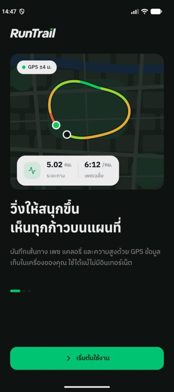 | 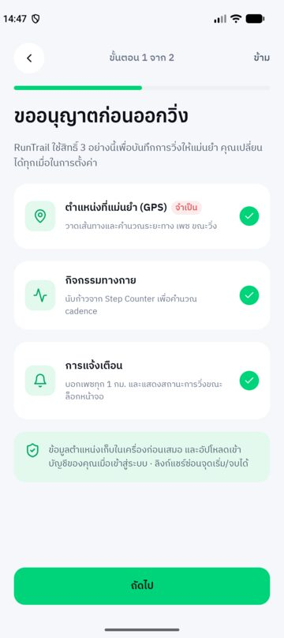 | 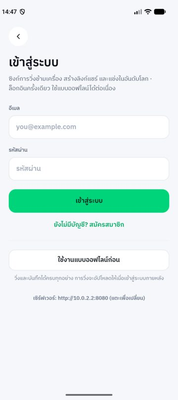 | 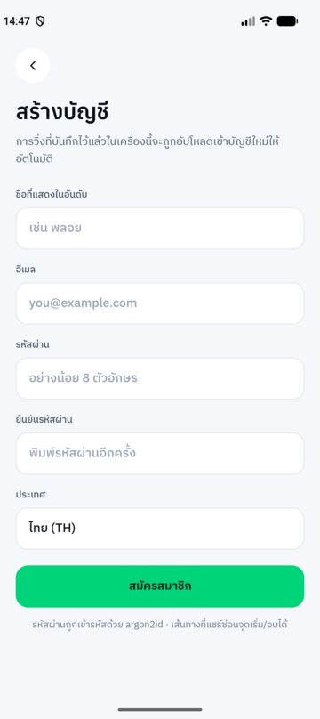 | 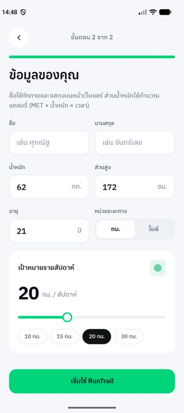 |

**วิ่งและดูผล**

| หน้าหลัก | วิ่งสด (GPS จริง) | หยุดชั่วคราว | สรุปผล | กราฟและ Splits |
|:---:|:---:|:---:|:---:|:---:|
| 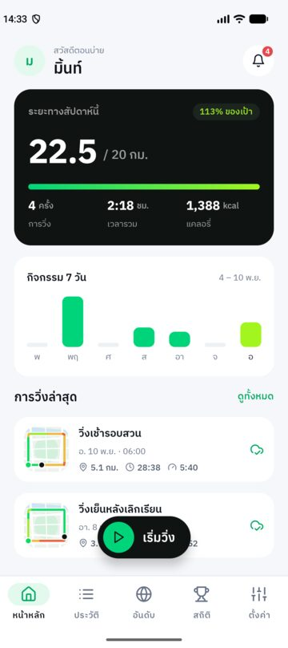 | 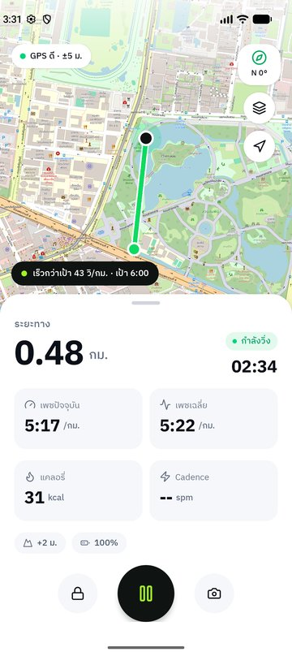 | 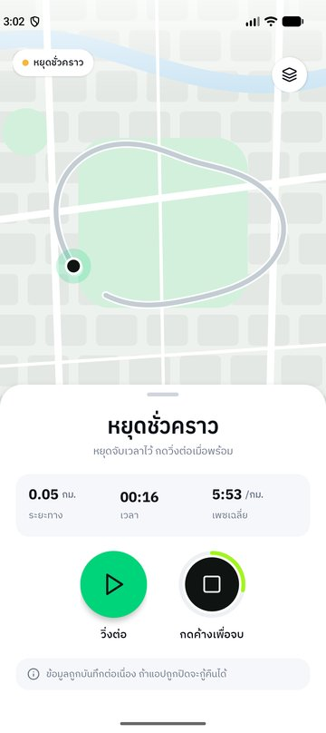 | 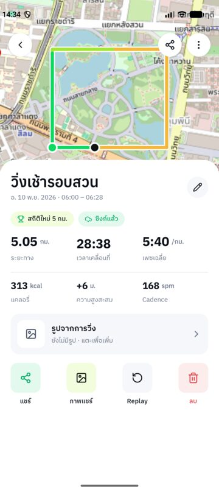 | 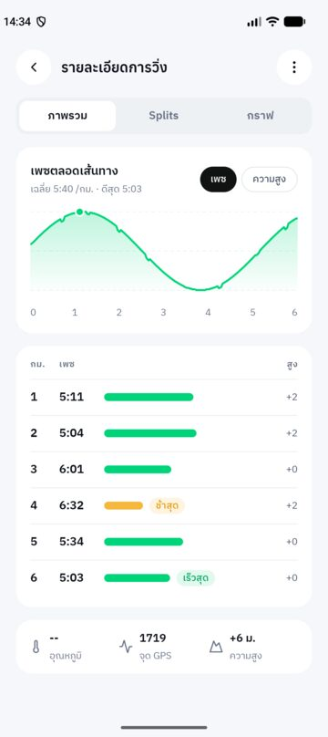 |

**แชร์และเปรียบเทียบ**

| แชร์และซิงก์ | ภาพแชร์ | หน้าเว็บแชร์ | อันดับโลก | การแจ้งเตือน |
|:---:|:---:|:---:|:---:|:---:|
| 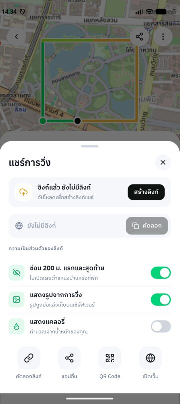 | 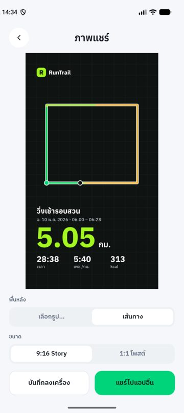 | 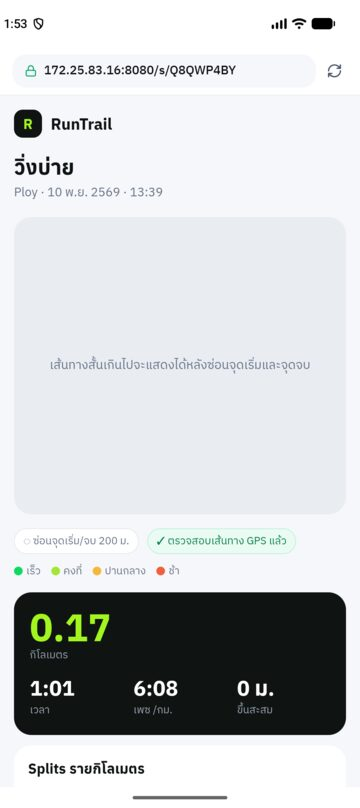 | 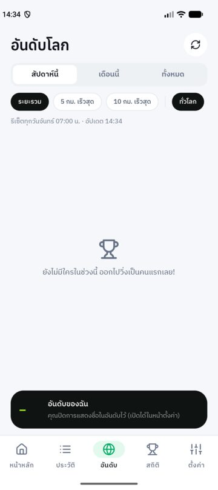 | 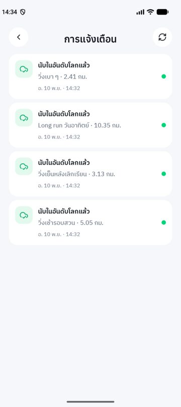 |

<details>
<summary><b>ดูหน้าจออื่น ๆ ทั้งหมด</b></summary>

| Replay | แก้ไขการวิ่ง | ประวัติ | สถิติส่วนตัว | ตั้งค่า |
|:---:|:---:|:---:|:---:|:---:|
| 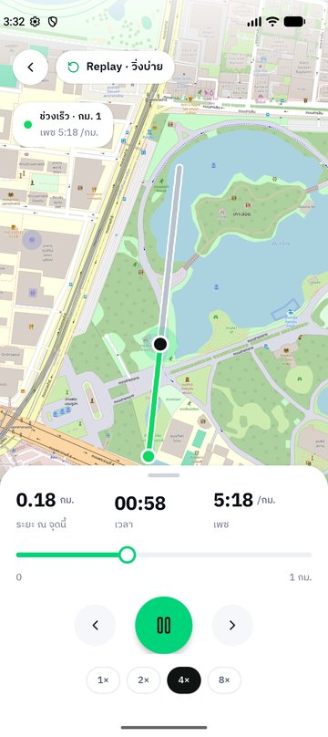 | 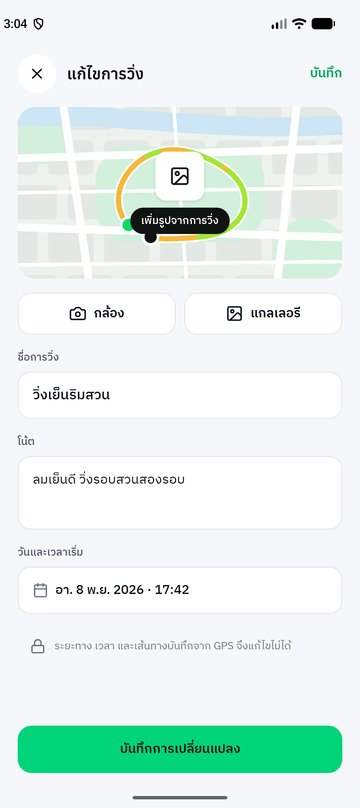 | 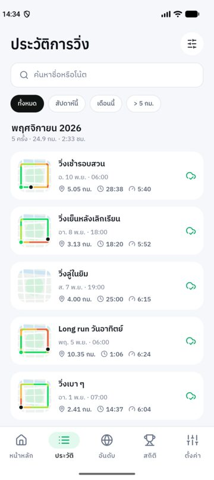 | 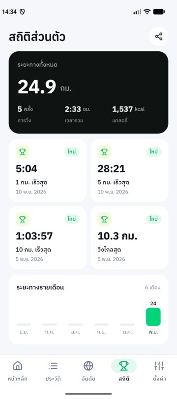 | 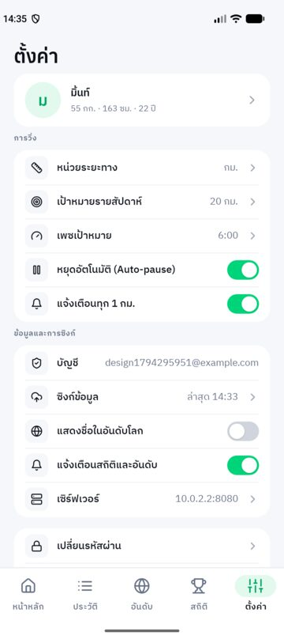 |

| กู้การวิ่งที่ค้าง | ยืนยันการลบ | ตัวเลือก (Bottom sheet) |
|:---:|:---:|:---:|
| 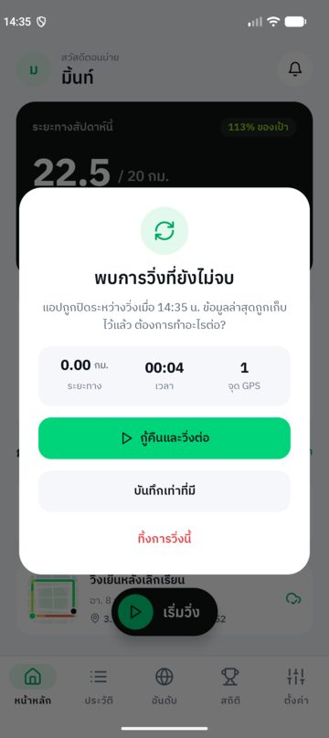 | 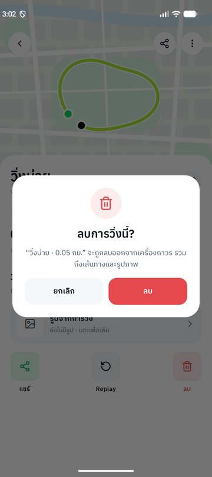 | 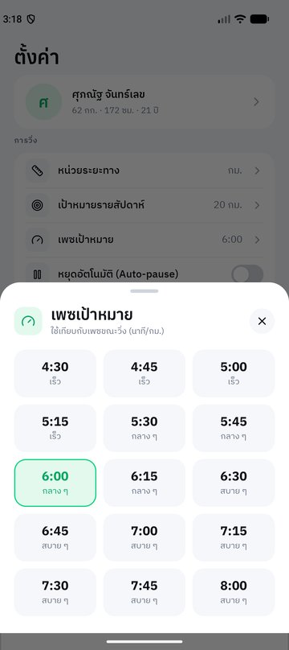 |

</details>

---

## ฟีเจอร์

### 🏃 บันทึกการวิ่ง
- อ่านตำแหน่งจาก GPS ทุก 1 วินาที กรองจุดคลาดเคลื่อน (ความแม่นยำแย่กว่า 25 ม. · เร็วเกิน 9 ม./วิ · ขยับน้อยกว่าค่าคลาดเคลื่อน)
- **Foreground service** — ปิดจอ สลับแอป หรือออกจากหน้าวิ่ง GPS และเวลายังเดินต่อ พร้อมการแจ้งเตือนค้างที่กดหยุด/วิ่งต่อได้
- ระยะ เวลา เพซปัจจุบัน (30 วินาทีล่าสุด) เพซเฉลี่ย แคลอรี่ Cadence ความสูงสะสม แบตเตอรี่ และป้ายเทียบเพซเป้าหมาย
- เส้นทางไล่สีตามเพซบนแผนที่ OpenStreetMap · โหมดแผนที่มืด · ปุ่มกลับตำแหน่งปัจจุบัน · เข็มทิศ
- **Auto-pause** เมื่อหยุดนิ่งเกิน 8 วินาที และวิ่งต่อเองเมื่อเริ่มเคลื่อนที่ · ช่วงที่หยุดไม่นับระยะ
- แจ้งเตือนทุก 1 กม. พร้อมเพซของกิโลนั้น
- **กดค้าง 1.5 วินาทีเพื่อจบ** · ล็อกปุ่ม · ถ่ายรูปเต็มความละเอียดแนบกับการวิ่ง
- **กู้การวิ่งที่ค้าง** — เขียนจุด GPS ลง SQLite ทุก 5 วินาที ถ้าแอปถูกปิดกลางคันจะกู้คืนได้ครบทุกจุด

### 📈 วิเคราะห์ผล
- สรุปผลหลังวิ่ง · ป้าย "สถิติใหม่" · สถานะซิงก์และสถานะในอันดับ (แตะเพื่อดูเหตุผล)
- Splits รายกิโลเมตร · กราฟเพซและความสูง · **Replay** ย้อนการวิ่งบนแผนที่ (1×–8×)
- สถิติส่วนตัว: ระยะ/เวลา/แคลอรี่รวม · 1 / 5 / 10 กม. เร็วสุด · วิ่งไกลสุด · กราฟรายเดือน

### 🗂 จัดการข้อมูล
- ประวัติแบบ RecyclerView จัดกลุ่มรายเดือน · ค้นหา · กรอง · เรียงลำดับ
- เพิ่มการวิ่งย้อนหลัง (บันทึกเอง ไม่นับเข้าอันดับ) · แก้ชื่อ โน้ต และรูป · ลบ (เลือกลบจากเซิร์ฟเวอร์ด้วยได้)

### ☁️ บัญชีและการซิงก์
- สมัคร / เข้าสู่ระบบ / **ใช้งานแบบออฟไลน์ก่อน (Guest)** แล้วล็อกอินทีหลัง การวิ่งเดิมจะถูกผูกบัญชีและอัปโหลดให้
- ซิงก์อัตโนมัติเมื่อมีเน็ต · ล็อกอินเครื่องใหม่ดึงประวัติคืนครบพร้อมเส้นทางและรูป
- เปลี่ยนรหัสผ่าน · ออกจากระบบ (เตือนถ้ายังมีรายการไม่ได้ซิงก์) · ลบบัญชี

### 🔗 แชร์
- **ลิงก์แชร์จริง** เปิดดูได้ในเบราว์เซอร์ (แผนที่ Leaflet + เส้นทางไล่สี + OG tag ให้พรีวิวใน LINE/Facebook)
- ตัวเลือกความเป็นส่วนตัว: **ซ่อน 200 ม. แรกและสุดท้าย** (ตัดที่เซิร์ฟเวอร์) · แสดงรูป · แสดงแคลอรี่
- คัดลอกลิงก์ · ส่งต่อแอปอื่น · QR Code · ยกเลิกลิงก์
- **ภาพแชร์** — สร้างภาพสรุปในเครื่อง (ไม่ต้องใช้เน็ต) พื้นหลังเป็นรูปจากการวิ่งหรือเส้นทาง ขนาด 9:16 (Story) / 1:1 (โพสต์) บันทึกลงแกลเลอรีหรือแชร์ต่อ

### 🏆 อันดับโลกและการแจ้งเตือน
- อันดับ ระยะรวม / 5 กม. เร็วสุด / 10 กม. เร็วสุด · สัปดาห์นี้ / เดือนนี้ / ทั้งหมด · ทั่วโลก / ประเทศของฉัน
- นับเฉพาะการวิ่ง GPS ที่เซิร์ฟเวอร์ตรวจแล้ว · แตะรายชื่อเพื่อดูสรุปของนักวิ่งคนนั้น · ปิดการแสดงชื่อได้
- **ศูนย์แจ้งเตือน** จากเหตุการณ์จริง: นับในอันดับแล้ว/ไม่นับ (บอกเหตุผล) · สถิติใหม่ · ถึงเป้าสัปดาห์ · มีคนแซงในอันดับ · มีคนเปิดดูลิงก์แชร์

### ⚙️ ตั้งค่าและอื่น ๆ
- Onboarding: แนะนำแอป → ขอสิทธิ์พร้อมเหตุผล → เข้าสู่ระบบ/Guest → โปรไฟล์และเป้าหมายรายสัปดาห์
- หน่วย กม./ไมล์ · เป้าหมายรายสัปดาห์ · เพซเป้าหมาย · Auto-pause · แจ้งเตือนทุก 1 กม. · แจ้งเตือนสถิติและอันดับ · ที่อยู่เซิร์ฟเวอร์
- ตรวจเซนเซอร์ของเครื่อง · ล็อกแนวตั้งทุกหน้า

---

## สถาปัตยกรรม

```
┌──────────────────── แอป Android (Kotlin + XML) ────────────────────┐
│  Activity (ViewBinding)                                            │
│     │ อ่าน/เขียน                                                     │
│     ▼                                                              │
│  RunRepository ──► SQLite  runs · run_points · splits              │ ◄─ แหล่งข้อมูลหลัก ใช้ได้ออฟไลน์
│  RunTrackingService (foreground, location) ── GPS ทำงานตอนปิดจอ    │
│  SyncEngine + WorkManager ── ส่ง/ดึงข้อมูลเมื่อมีเน็ต                  │
│     │ OkHttp + JWT (refresh token อัตโนมัติ, gzip)                  │
└─────┼──────────────────────────────────────────────────────────────┘
      │ HTTPS /api/v1
      ▼
┌──────────────────── Backend (Go + Fiber, Docker) ──────────────────┐
│  auth · users · runs · photos · share · leaderboard · notifications│
│     │                          │                                   │
│     ▼                          ▼                                   │
│  PostgreSQL 17           S3 / RustFS (presigned URL)               │
└────────────────────────────────────────────────────────────────────┘
      หน้าเว็บแชร์  http://<host>:8080/s/{code}
```

- รูปภาพอัปโหลดจากมือถือ **ตรงไป S3** ด้วย presigned URL (ไม่ผ่าน Go)
- เซิร์ฟเวอร์ **คำนวณระยะใหม่จากจุด GPS** ด้วยสูตรเดียวกับแอป และตรวจความน่าเชื่อก่อนนับเข้าอันดับ

---

## เทคโนโลยีที่ใช้

**แอป Android**

| ส่วน | ที่เลือกใช้ |
|---|---|
| ภาษา / UI | Kotlin 100% · XML Layout + ViewBinding · Material Components (Material3) |
| Build | Gradle Kotlin DSL · Version Catalog · AGP 9.3.3 · `compileSdk 37` · `minSdk 28` · `targetSdk 37` |
| ฐานข้อมูล | SQLite (`SQLiteOpenHelper`) |
| เครือข่าย | OkHttp 5 · `org.json` · token เข้ารหัส AES-GCM ด้วย Android Keystore |
| งานเบื้องหลัง | WorkManager (ซิงก์) · Foreground Service (บันทึกการวิ่ง) |
| แผนที่ / ตำแหน่ง | osmdroid 6.1 (OpenStreetMap) · `LocationManager` (GPS) |
| เซนเซอร์ | Step Counter · Rotation Vector · Magnetometer · Accelerometer · Barometer · Light · Temperature |
| อื่น ๆ | ZXing (QR) · ExifInterface · กราฟและภาพแชร์วาดเองด้วย `Canvas` |
| ฟอนต์ / ไอคอน | Anuphan · IBM Plex Sans Thai · Lucide |

**Backend**

| ส่วน | ที่เลือกใช้ |
|---|---|
| ภาษา / Framework | Go 1.27 · Fiber v3 |
| ฐานข้อมูล | PostgreSQL 17 · pgx v5 · goose (migration ฝังใน binary) |
| เก็บไฟล์ | S3 API (aws-sdk-go-v2) · RustFS ตอนรันในเครื่อง / AWS S3 ตอนขึ้นจริง |
| ความปลอดภัย | argon2id · JWT (HS256) · refresh token แบบหมุนเวียน · rate limit |
| รันระบบ | Docker multi-stage (distroless) · Docker Compose · Makefile |
| ทดสอบ | `go test` + testcontainers (Postgres จริง) · `scripts/smoke.sh` |

---

## โครงสร้างโปรเจค

```
RunTrail/
├── app/                                  แอป Android
│   └── src/
│       ├── main/java/com/example/runtrail/
│       │   ├── App.kt                    เริ่มแอป: เปิด DB · สร้างตัวเชื่อม backend · ตั้งเวลาซิงก์
│       │   ├── data/                     Run · RunDb (SQLite) · RunRepository · PrefsHelper · Accounts
│       │   ├── domain/                   Kotlin ล้วน (ทดสอบบน JVM ได้)
│       │   │                             TrackMath · RunCalculator · LiveRunState · Codec · Fmt ·
│       │   │                             PaceColor · Periods · RouteGenerator · ShareImageLayout
│       │   ├── net/                      ApiClient (OkHttp + refresh) · RunTrailApi · RunJson · TokenStore
│       │   ├── sync/                     SyncEngine · SyncManager (WorkManager)
│       │   ├── service/                  RunTrackingService (foreground, type=location)
│       │   ├── sensor/                   LocationTracker · CadenceTracker · CompassHelper · SensorHelper
│       │   └── ui/
│       │       ├── onboarding/           Welcome · Permissions · ProfileSetup
│       │       ├── auth/                 Login · Register
│       │       ├── home/                 หน้าหลัก
│       │       ├── live/                 วิ่งสด
│       │       ├── detail/               สรุปผล · กราฟ/Splits
│       │       ├── replay/  edit/        Replay · เพิ่ม/แก้ไขการวิ่ง
│       │       ├── history/  records/    ประวัติ · สถิติส่วนตัว
│       │       ├── leaderboard/          อันดับโลก
│       │       ├── notifications/        ศูนย์แจ้งเตือน · Notifier
│       │       ├── share/                ShareSheet · ภาพแชร์ · หน้าเว็บแชร์
│       │       ├── settings/  sensor/    ตั้งค่า · ตรวจเซนเซอร์
│       │       ├── common/               BottomNav · Dialogs · Sheets · Async · ImageStore ฯลฯ
│       │       └── widget/               MapRouteView · OsmRoute · กราฟ · HoldToStop · ToggleSwitch
│       ├── main/res/                     layout · drawable · font · values (ภาษาไทยทั้งหมด) · xml
│       ├── debug/                        อนุญาต HTTP + สิทธิ์เครือข่ายภายใน (เฉพาะ build debug)
│       ├── test/                         JVM unit test
│       └── androidTest/                  instrumented test (SQLite · ปิดจอ · ซิงก์กับ backend จริง)
├── backend/                              เซิร์ฟเวอร์ Go
│   ├── cmd/api/                          main: config → DB → migrate → listen
│   ├── internal/
│   │   ├── api/                          handler ทุก endpoint + หน้าเว็บแชร์ (templates/)
│   │   ├── track/                        คำนวณระยะ/splits/best effort · ตรวจโกง · ตัด 200 ม.
│   │   ├── auth/                         argon2id · JWT · refresh token · share code
│   │   ├── db/                           pgx pool + migrations
│   │   ├── storage/                      S3 client (+ ตัวจำลองสำหรับ test)
│   │   ├── httpx/                        รูปแบบ error · อ่าน JSON/gzip · validation
│   │   └── config/                       env vars
│   ├── scripts/smoke.sh                  ทดสอบทั้ง flow กับเซิร์ฟเวอร์จริง
│   ├── docker-compose.yml  Dockerfile  Makefile  .env.example
│   └── README.md                         วิธีรัน + เอกสาร API ฉบับเต็ม
├── tools/gps-bridge/                     ส่ง GPS จริงจาก iPhone เข้า Emulator
├── docs/
│   ├── BACKEND_PLAN.md                   แผนและการตัดสินใจออกแบบระบบ
│   ├── prompts/                          prompt ที่ใช้สั่งงาน AI
│   ├── screenshots/                      ภาพหน้าจอใน README
│   └── logo.png
└── gradle/  build.gradle.kts  settings.gradle.kts
```

---

## เริ่มต้นใช้งาน

### สิ่งที่ต้องมี
- Android Studio (รองรับ AGP 9.3.3) + Android SDK 37 · อุปกรณ์หรือ Emulator Android 9 ขึ้นไป
- Docker Desktop (สำหรับ backend) · `make` · `jq` (ใช้กับ smoke test)

### 1) ดาวน์โหลดโปรเจค
```bash
git clone https://github.com/suphanatchanlek30/RunTrail.git
cd RunTrail
```

### 2) รัน backend
```bash
cd backend
make env      # สร้าง .env: ใส่ IP ของเครื่องและสุ่มรหัสลับให้ (ครั้งแรกเท่านั้น)
make up       # build + รัน PostgreSQL, RustFS (S3) และ API
curl localhost:8080/readyz     # {"db":"ok","storage":"ok"}
```
รายละเอียดทั้งหมดอยู่ที่ [`backend/README.md`](backend/README.md)

### 3) รันแอป
เปิดโฟลเดอร์ `RunTrail` ใน Android Studio → รอ Gradle sync → เลือกอุปกรณ์ → **Run ▶**
หรือผ่าน command line:
```bash
./gradlew assembleDebug        # ไฟล์ APK: app/build/outputs/apk/debug/app-debug.apk
```

### 4) เชื่อมแอปกับ backend
ในหน้าเข้าสู่ระบบ แตะ **"เซิร์ฟเวอร์"** แล้วใส่ที่อยู่:

| อุปกรณ์ | ที่อยู่ |
|---|---|
| Emulator | `http://10.0.2.2:8080` (ค่าเริ่มต้น) |
| มือถือจริง (Wi-Fi เดียวกับเครื่องที่รัน backend) | `http://<IP ของเครื่อง>:8080` — ดู IP ด้วย `ipconfig getifaddr en0` |

- Android 17 จะถามสิทธิ์ **"อุปกรณ์ใกล้เคียง/เครือข่ายภายใน"** ต้องกด **อนุญาต** ไม่อย่างนั้นต่อเซิร์ฟเวอร์ในวง Wi-Fi ไม่ได้
- ถ้า IP ของเครื่องเปลี่ยน ให้แก้ `HOST_IP`, `PUBLIC_BASE_URL`, `S3_PUBLIC_ENDPOINT` ใน `backend/.env` แล้ว `make up` ใหม่ (ลิงก์แชร์และรูปอ้างอิง IP นี้)
- ไม่ล็อกอินก็ใช้งานได้ (Guest) — การวิ่งจะรออยู่ในเครื่องและอัปโหลดเมื่อเข้าสู่ระบบ

---

## ทดสอบด้วย GPS

**Emulator — Extended Controls**: `⋯` → **Location** → แท็บ **Routes** → วาดเส้นทางหรือโหลด GPX → **Play route**

**Emulator — คำสั่ง adb** (`ลองจิจูด ละติจูด ความสูง` ทีละจุด ทุก 1 วินาที)
```bash
adb emu geo fix 100.5385 13.7290 5
adb emu geo fix 100.5386 13.7293 5
```

**ใช้ GPS จริงจาก iPhone** (ไม่มีมือถือ Android): ถือโน้ตบุ๊กกับ iPhone ออกไปวิ่งได้จริง
ดูวิธีที่ [`tools/gps-bridge/README.md`](tools/gps-bridge/README.md)
```
iPhone (Safari) → Cloudflare Tunnel (HTTPS) → bridge.py → adb emu geo fix → Emulator
```

> 💡 เครื่องจริงให้ผลดีที่สุด — Emulator ไม่มี Step Counter และเซนเซอร์บางตัว (ช่อง Cadence จะเป็น `--`)

---

## การทดสอบอัตโนมัติ (Test)

| ชุด | คำสั่ง | ครอบคลุม |
|---|---|---|
| แอป · JVM (32 ข้อ) | `./gradlew testDebugUnitTest` | สูตร TrackMath/RunCalculator · สถานะการวิ่งสด (auto-pause, ช่วงหยุด, จุด GPS มาเป็นชุด, จุดแรกค้าง) · JSON · HTTP client (refresh token พร้อมกันแล้ว refresh ครั้งเดียว, gzip) · ตำแหน่งในภาพแชร์ |
| แอป · บนเครื่อง (12 ข้อ) | `./gradlew connectedDebugAndroidTest -Pe2eApiUrl=http://10.0.2.2:8080` | SQLite · **บันทึกต่อเนื่องตอนปิดจอ** · วาดภาพแชร์ · **ซิงก์กับ backend จริงทั้งวงจร** (ออฟไลน์ → ซิงก์ครั้งเดียว → รูปขึ้น S3 → ลิงก์แชร์ → แก้/ลบ → เครื่องใหม่ดึงคืน) |
| Backend · Go | `cd backend && make test` | unit + integration กับ PostgreSQL จริง: auth, last-write-wins, UUID ของคนอื่น, gzip bomb, sync cursor, รูป, อันดับ, แชร์ซ่อนบ้าน, การแจ้งเตือน, ลบบัญชี |
| Backend · smoke (29 ข้อ) | `cd backend && make smoke` | ทั้ง flow ผ่าน HTTP กับ Docker จริง |

> ⚠️ `connectedDebugAndroidTest` จะ **ถอนแอปออกจากเครื่องหลังรันเสร็จ** (ข้อมูลในแอปหาย) ถ้ากำลังใช้แอปอยู่ ให้ใช้ `installDebug installDebugAndroidTest` แล้วรัน `adb shell am instrument` แทน

---

## API โดยสรุป

ทุก endpoint อยู่ใต้ `/api/v1` (🔒 = ต้องส่ง `Authorization: Bearer <token>`) — ฉบับเต็มพร้อมตัวอย่างอยู่ที่ [`backend/README.md`](backend/README.md)

| กลุ่ม | Endpoint |
|---|---|
| บัญชี | `POST /auth/register` · `/auth/login` · `/auth/refresh` · `/auth/logout` · `/auth/change-password` 🔒 |
| ผู้ใช้ 🔒 | `GET/PATCH/DELETE /me` · `GET /me/stats` · `/me/avatar/*` · `GET /users/{id}/summary` |
| การวิ่ง 🔒 | `PUT /runs/{uuid}` (upsert) · `PATCH` · `DELETE` · `GET /runs?updated_since=&cursor=` · `GET /runs/{uuid}` · `/track` |
| รูป 🔒 | `POST /runs/{uuid}/photo/upload-url` → PUT ไป S3 → `POST …/photo/confirm` · `DELETE …/photo` |
| แชร์ | `POST/DELETE /runs/{uuid}/share` 🔒 · `GET /public/runs/{code}` · หน้าเว็บ `GET /s/{code}` |
| อันดับ 🔒 | `GET /leaderboard?metric=&period=&scope=` · `GET /leaderboard/me` |
| แจ้งเตือน 🔒 | `GET /notifications` · `POST /notifications/read` |
| ระบบ | `GET /healthz` · `GET /readyz` |

---

## สูตรคำนวณและการตรวจการวิ่ง

| ค่า | สูตร |
|---|---|
| ระยะทางระหว่าง 2 จุด | Haversine: `d = 2R·asin(√(sin²(Δφ/2) + cosφ₁·cosφ₂·sin²(Δλ/2)))`, R = 6,371 กม. |
| เพซ (วินาที/กม.) | `เวลาเคลื่อนที่ ÷ (ระยะทาง ÷ 1000)` |
| เพซปัจจุบัน | ระยะและเวลาของจุด GPS ใน 30 วินาทีล่าสุด |
| แคลอรี่ | `MET × น้ำหนัก(กก.) × ชั่วโมง` โดย `MET = (0.2 × ความเร็ว(ม./นาที) + 3.5) ÷ 3.5` (ACSM) |
| Split | เวลาที่ผ่านแต่ละหลักกิโลเมตร ประมาณเชิงเส้นระหว่างจุด GPS |
| ความสูงสะสม | รวมเฉพาะช่วงขึ้น ตัดการแกว่งต่ำกว่า 2 ม. |
| Cadence | ก้าวที่เพิ่มขึ้นใน 30 วินาทีล่าสุด ÷ เวลาเป็นนาที |
| สีตามเพซ | เร็ว < 5:50 · คงที่ ≤ 6:15 · ปานกลาง ≤ 6:40 · ช้ากว่านั้น |
| Best 1/5/10 กม. (server) | ช่วงที่เร็วที่สุดจริงในเส้นทาง (sliding window) |

**เซิร์ฟเวอร์นับการวิ่งเข้าอันดับเมื่อผ่านทุกข้อ** (ไม่ผ่านก็ยังเก็บไว้ แต่ไม่นับ และบอกเหตุผลในแอป):
อย่างน้อย 30 จุด · จุดห่างกันไม่เกิน 10 วินาที · ระยะต่างจากแอปไม่เกิน 5% · เพซเฉลี่ยไม่เร็วกว่า 2:50/กม. ·
ไม่มีช่วง 30 วินาทีที่เร็วกว่า 7 ม./วิ · เวลาไม่อยู่ในอนาคต · ระยะช่วงที่กดหยุดไม่นับ · การวิ่งที่บันทึกเองไม่นับ

---

## ความเป็นส่วนตัวและความปลอดภัย

- รหัสผ่านเข้ารหัสด้วย **argon2id** · access token อายุ 15 นาที · refresh token หมุนทุกครั้ง ใช้ซ้ำ = ยกเลิกทั้งชุด
- token ในเครื่องเข้ารหัส **AES-GCM ด้วย Android Keystore** และไม่ถูกสำรองไปเครื่องอื่น
- ทุก query ตรวจเจ้าของข้อมูล · ส่งการวิ่งด้วย UUID ของคนอื่นถูกปฏิเสธ (409)
- **ซ่อน 200 ม. รอบจุดเริ่ม/จบที่เซิร์ฟเวอร์** ก่อนส่งให้คนอื่น และไม่เปิดเผยเวลาของแต่ละจุด
- S3 bucket ปิดสาธารณะ เข้าถึงผ่าน presigned URL อายุสั้นเท่านั้น
- release build ใช้ HTTPS เท่านั้น (HTTP อนุญาตเฉพาะ build debug)
- ไฟล์ลับ (`.env`, key, keystore, state ของ Terraform) อยู่ใน `.gitignore`

---

## สิทธิ์ที่แอปขอ

| สิทธิ์ | เหตุผล |
|---|---|
| `ACCESS_FINE_LOCATION` / `ACCESS_COARSE_LOCATION` | บันทึกเส้นทางและคำนวณระยะทาง (จำเป็น) |
| `FOREGROUND_SERVICE` / `FOREGROUND_SERVICE_LOCATION` | บันทึก GPS ต่อเนื่องขณะปิดจอ |
| `ACTIVITY_RECOGNITION` | อ่าน Step Counter เพื่อคำนวณ Cadence |
| `POST_NOTIFICATIONS` | สถานะการวิ่ง · เพซทุก 1 กม. · สถิติใหม่และอันดับ |
| `INTERNET` / `ACCESS_NETWORK_STATE` | แผนที่ OpenStreetMap และซิงก์กับ backend |
| `WRITE_EXTERNAL_STORAGE` (Android 9 เท่านั้น) | บันทึกภาพแชร์ลงแกลเลอรี |
| `ACCESS_LOCAL_NETWORK` (debug เท่านั้น) | Android 17: ต่อ backend ที่รันในวง Wi-Fi / Emulator |

เซนเซอร์ทุกตัวประกาศ `required="false"` เครื่องที่ไม่มีบางตัวยังติดตั้งและใช้งานได้

---

## การนำเนื้อหา MA09–MA12 มาใช้

| บทเรียน | ใช้ในโปรเจค |
|---|---|
| **MA09** ข้อมูลภายในเครื่อง + คืนสถานะ | `SharedPreferences` (โปรไฟล์ ตั้งค่า สถานะซิงก์) · ไฟล์รูปในพื้นที่แอป · `onSaveInstanceState` ทุกหน้าที่มีสถานะ |
| **MA10** SQLite + RecyclerView + รูปภาพ | `RunDb` (`SQLiteOpenHelper`: runs · run_points · splits) · `RunRepository` CRUD/ค้นหา/กรอง/เรียง · RecyclerView ในประวัติ อันดับ การแจ้งเตือน · กล้อง/แกลเลอรี + EXIF |
| **MA11** ฐานข้อมูลออนไลน์ | Backend Go + PostgreSQL · REST API + JWT · ซิงก์ด้วย OkHttp + WorkManager · ลิงก์แชร์และหน้าเว็บ |
| **MA12** เซนเซอร์ | GPS (`LocationTracker` + foreground service) · Step Counter (Cadence) · เข็มทิศ · หน้าตรวจเซนเซอร์ |

---

## ระบบออกแบบ (Design System)

ออกแบบใน Figma โทน **ขาว · เขียว · เทา · ดำ**

| โทเคน | สี | ใช้กับ |
|---|---|---|
| Green | `#00D47A` | ปุ่มหลัก · เส้นทาง · สถานะสำเร็จ |
| Lime | `#A3F51F` | ไฮไลต์บนพื้นดำ · วงแหวนกดค้างเพื่อจบ |
| Ink | `#0F1412` | การ์ดสรุป · ปุ่มเริ่มวิ่ง · ชิปที่เลือก |
| White | `#FFFFFF` | การ์ด · Bottom sheet |
| Canvas | `#F5F7FA` | พื้นหลังหน้าจอ · ไทล์ |
| Gray | `#667085` | ข้อความรอง |

**Pace scale:** `#0EDA62` → `#A3E635` → `#F5B83D` → `#F0603F`

Text styles อยู่ใน `res/values/styles_text.xml` และ component styles อยู่ใน `res/values/styles_components.xml`

---

## ข้อจำกัดและแผนถัดไป

**ข้อจำกัดตอนนี้**
- แผนที่ใช้ tile ของ OpenStreetMap (ฟรี ไม่ต้องใช้ key) เหมาะกับงานสาธิต ถ้าผู้ใช้เยอะควรใช้ผู้ให้บริการแผนที่ของตัวเอง
- backend รันในเครื่อง (Docker) มือถือจริงต้องอยู่ Wi-Fi เดียวกันจึงจะซิงก์ได้
- รองรับโหมดสว่างเท่านั้น (ตามดีไซน์ Figma)

**แผนถัดไป**
- [ ] ขึ้น AWS ด้วย Terraform (EC2 + S3 + HTTPS) ตามแผนใน [`docs/BACKEND_PLAN.md`](docs/BACKEND_PLAN.md) ข้อ 6
- [ ] ลืมรหัสผ่านทางอีเมล
- [ ] ดาวน์โหลดแผนที่ไว้ใช้ออฟไลน์
- [ ] โหมดมืด

---

## เอกสารเพิ่มเติม

| ไฟล์ | เนื้อหา |
|---|---|
| [`backend/README.md`](backend/README.md) | วิธีรัน backend · คำสั่ง Make · API ฉบับเต็มพร้อมตัวอย่าง request/response · รหัส error |
| [`docs/BACKEND_PLAN.md`](docs/BACKEND_PLAN.md) | แผนระบบ · schema · การตัดสินใจออกแบบ · สิ่งที่เปลี่ยนจากแผนระหว่างทำ |
| [`tools/gps-bridge/README.md`](tools/gps-bridge/README.md) | ทดสอบด้วย GPS จริงจาก iPhone |
| [`docs/prompts/BACKEND_PROMPT.md`](docs/prompts/BACKEND_PROMPT.md) | prompt ที่ใช้สั่งงาน AI สร้าง backend และเชื่อมแอป |

---

## เครดิตและสัญญาอนุญาต

| ทรัพยากร | สัญญาอนุญาต |
|---|---|
| ข้อมูลแผนที่ © [OpenStreetMap contributors](https://www.openstreetmap.org/copyright) | ODbL |
| [osmdroid](https://github.com/osmdroid/osmdroid) · [ZXing](https://github.com/zxing/zxing) · [OkHttp](https://github.com/square/okhttp) · AndroidX · Material Components | Apache License 2.0 |
| [Leaflet](https://leafletjs.com) (หน้าเว็บแชร์) | BSD-2-Clause |
| [Fiber](https://github.com/gofiber/fiber) · [pgx](https://github.com/jackc/pgx) · [goose](https://github.com/pressly/goose) | MIT |
| [aws-sdk-go-v2](https://github.com/aws/aws-sdk-go-v2) · [RustFS](https://github.com/rustfs/rustfs) | Apache License 2.0 |
| ฟอนต์ [Anuphan](https://fonts.google.com/specimen/Anuphan) · [IBM Plex Sans Thai](https://fonts.google.com/specimen/IBM+Plex+Sans+Thai) | SIL Open Font License 1.1 |
| ไอคอน [Lucide](https://lucide.dev) | ISC License |

> การใช้ภาพแผนที่จากเซิร์ฟเวอร์ของ OpenStreetMap เป็นไปตาม [Tile Usage Policy](https://operations.osmfoundation.org/policies/tiles/) — แอปตั้ง User-Agent ของตัวเองและแสดงเครดิตทุกหน้าที่มีแผนที่

---

<div align="center">

พัฒนาเพื่อการศึกษา · CS364 Mobile Application Development<br/>
**ศุภณัฐ จันทร์เลข** · 6709616897

</div>
