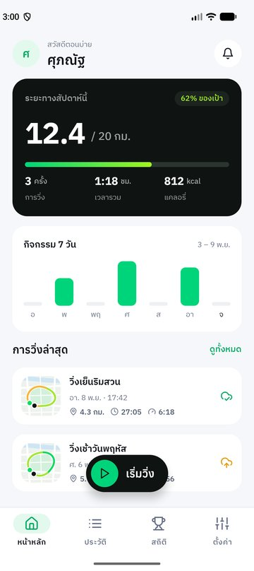
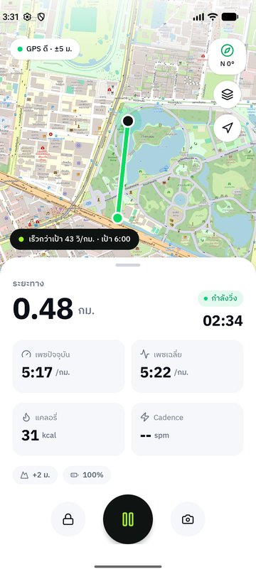
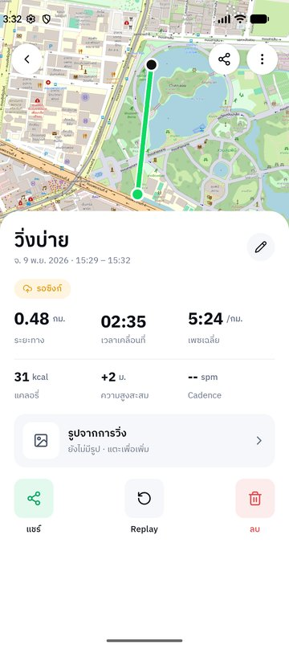
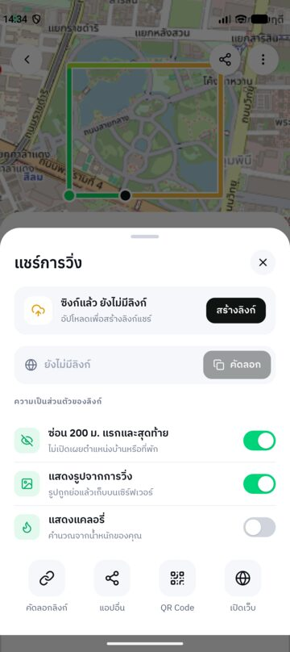
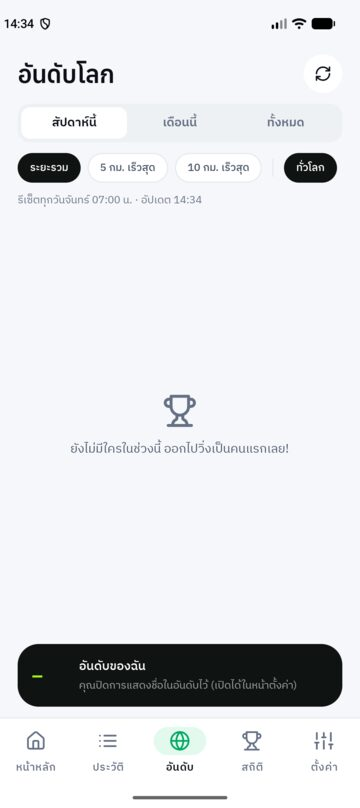
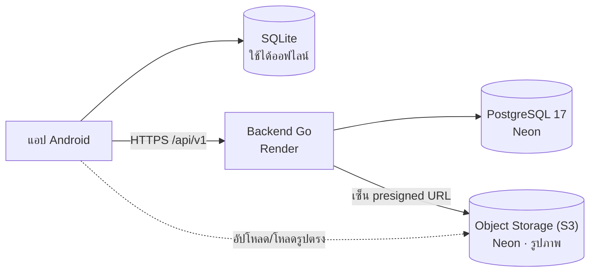

<div align="center">


# RunTrail

**แอปบันทึกการวิ่งด้วย GPS ใช้ได้แม้ไม่มีเน็ต ซิงก์ขึ้นเซิร์ฟเวอร์ แชร์เส้นทาง และแข่งอันดับ**


โครงงานรายวิชา CS364 Mobile Application Development<br/>
ศุภณัฐ จันทร์เลข · 6709616897

</div>

---

## สารบัญ

1. [ภาพรวม](#ภาพรวม)
2. [ภาพหน้าจอ](#ภาพหน้าจอ)
3. [ฟีเจอร์](#ฟีเจอร์)
4. [สถาปัตยกรรม](#สถาปัตยกรรม)
5. [เทคโนโลยีที่ใช้](#เทคโนโลยีที่ใช้)
6. [โครงสร้างโปรเจค](#โครงสร้างโปรเจค)
7. [เริ่มต้นใช้งาน](#เริ่มต้นใช้งาน)
8. [ทดสอบด้วย GPS](#ทดสอบด้วย-gps)
9. [การทดสอบอัตโนมัติ (Test)](#การทดสอบอัตโนมัติ-test)
10. [API โดยสรุป](#api-โดยสรุป)
11. [สูตรคำนวณและการตรวจการวิ่ง](#สูตรคำนวณและการตรวจการวิ่ง)
12. [ความเป็นส่วนตัวและความปลอดภัย](#ความเป็นส่วนตัวและความปลอดภัย)
13. [สิทธิ์ที่แอปขอ](#สิทธิ์ที่แอปขอ)
14. [การนำเนื้อหา MA08–MA13 มาใช้](#การนำเนื้อหา-ma08ma13-มาใช้)
15. [ระบบออกแบบ (Design System)](#ระบบออกแบบ-design-system)
16. [ข้อจำกัดและแผนถัดไป](#ข้อจำกัดและแผนถัดไป)
17. [เอกสารเพิ่มเติม](#เอกสารเพิ่มเติม)
18. [ไลบรารีและลิขสิทธิ์](#ไลบรารีและลิขสิทธิ์)

---

## ภาพรวม

RunTrail มี 2 ส่วนที่ทำงานร่วมกัน

| ส่วน | ทำอะไร |
|---|---|
| **แอป Android** (`app/`) | บันทึก GPS ลงแผนที่ เก็บทุกอย่างใน SQLite ใช้ได้ครบแม้ไม่มีเน็ต |
| **Backend** (`backend/`) | บัญชีผู้ใช้ ซิงก์การวิ่ง เก็บรูป ลิงก์แชร์ อันดับโลก และการแจ้งเตือน |

กดเริ่มวิ่งได้ทันทีแม้ไม่มีเน็ต แอปบันทึกลงเครื่องก่อน แล้วอัปโหลดให้เองเมื่อกลับมาออนไลน์

**ระบบจริง:** backend ทำงานอยู่ที่ **<https://runtrail-api.onrender.com>** (Render + Neon แพ็กเกจฟรี)
ติดตั้ง APK แล้วสมัครบัญชีได้ทันที ไม่ต้องตั้งค่าเซิร์ฟเวอร์เอง

## ภาพหน้าจอ

| หน้าหลัก | วิ่งสด | สรุปผล | แชร์ | อันดับโลก |
|:---:|:---:|:---:|:---:|:---:|
|  |  |  |  |  |

👉 [ดูภาพหน้าจอทั้งหมด 23 หน้า](docs/FEATURES.md#ภาพหน้าจอ)

## ฟีเจอร์

- 🏃 **บันทึกการวิ่ง** ด้วย GPS ทำงานต่อแม้ปิดจอ มี auto-pause และกู้คืนได้ถ้าแอปถูกปิดกลางคัน
- 📈 **วิเคราะห์ผล** splits รายกิโลเมตร กราฟเพซและความสูง Replay บนแผนที่ และสถิติส่วนตัว
- 🗂 **จัดการข้อมูล** ค้นหา กรอง เรียง เพิ่มการวิ่งย้อนหลัง ส่งออก/นำเข้าไฟล์สำรอง
- ☁️ **บัญชีและการซิงก์** ใช้แบบ Guest ก่อนได้ ล็อกอินเครื่องใหม่แล้วประวัติกลับมาครบ
- 🔗 **แชร์** ลิงก์หน้าเว็บ (ซ่อน 200 ม. รอบบ้าน) ภาพแชร์ และ QR Code
- 🏆 **อันดับโลกและการแจ้งเตือน** ระยะรวม 5K และ 10K นับเฉพาะการวิ่งที่เซิร์ฟเวอร์ตรวจแล้ว
- ⏰ **เตือนไปวิ่ง** ตามเวลาและวันที่เลือก
- 🌗 **ไทย / อังกฤษ** และโหมดกลางวัน / กลางคืน

👉 [อ่านรายละเอียดฟีเจอร์ทั้งหมด](docs/FEATURES.md#ฟีเจอร์)

## สถาปัตยกรรม



ตอนพัฒนาในเครื่อง ทั้ง 3 ส่วนรันด้วย Docker Compose (Go API · PostgreSQL · RustFS แทน S3) โค้ดชุดเดียวกัน ต่างกันแค่ env

👉 [ดูแผนภาพเต็มและคำอธิบาย](docs/ARCHITECTURE.md#สถาปัตยกรรม)

## เทคโนโลยีที่ใช้

| ส่วน | ใช้ |
|---|---|
| แอป | Kotlin · XML + ViewBinding · Material 3 · SQLite · Volley · OkHttp · WorkManager · osmdroid |
| Backend | Go · Fiber · PostgreSQL · S3 API · JWT + argon2id · Docker |
| ระบบจริง | Render (backend) · Neon (PostgreSQL + Object Storage) · ในเครื่องใช้ Docker Compose + RustFS |

👉 [ดูรายการเทคโนโลยีทั้งหมดและเวอร์ชัน](docs/ARCHITECTURE.md#เทคโนโลยีที่ใช้)

## โครงสร้างโปรเจค

```
RunTrail/
├── app/        แอป Android (data · domain · net · sync · service · sensor · reminder · ui)
├── backend/    เซิร์ฟเวอร์ Go (api · track · auth · db · storage)
├── tools/      gps-bridge: ส่ง GPS จริงจาก iPhone เข้า Emulator
└── docs/       เอกสารรายละเอียด · ภาพหน้าจอ
```

👉 [ดูโครงสร้างทุกโฟลเดอร์](docs/ARCHITECTURE.md#โครงสร้างโปรเจค)

## เริ่มต้นใช้งาน

**ใช้งานจริง (แนะนำ):** ติดตั้ง `RunTrail-1.1.apk` (release) บนมือถือ Android 9 ขึ้นไป → สมัครบัญชี → ใช้ได้ทุกฟีเจอร์
แอปต่อ `https://runtrail-api.onrender.com` ให้เอง ใช้ได้ทั้ง 4G และ Wi-Fi

```bash
./gradlew assembleRelease    # build APK เอง → app/build/outputs/apk/release/app-release.apk
```

**พัฒนาในเครื่อง:**

```bash
cd backend && make env && make up    # รัน backend (ต้องมี Docker)
```

จากนั้นเปิดโปรเจคใน Android Studio แล้วกด **Run ▶** บน Emulator แอป debug ต่อ `http://10.0.2.2:8080` ให้เอง

👉 [ขั้นตอนเต็ม: ติดตั้ง APK · signing · ต่อจากมือถือจริง](docs/SETUP.md#เริ่มต้นใช้งาน)

## ทดสอบด้วย GPS

ใช้ Extended Controls ของ Emulator (Location → Routes) หรือคำสั่ง `adb emu geo fix` หรือส่ง GPS จริงจาก iPhone

👉 [วิธีทดสอบด้วย GPS ทั้ง 3 แบบ](docs/SETUP.md#ทดสอบด้วย-gps)

## การทดสอบอัตโนมัติ (Test)

| ชุด | คำสั่ง |
|---|---|
| แอป · JVM (77 ข้อ) | `./gradlew testDebugUnitTest` |
| แอป · บนเครื่อง (41 ข้อ) | `./gradlew connectedDebugAndroidTest -Pe2eApiUrl=http://10.0.2.2:8080` |
| Backend | `cd backend && make test` |
| ระบบจริง · smoke (29 ข้อ) | `cd backend && make deploy-check URL=https://runtrail-api.onrender.com` |

👉 [ดูว่าแต่ละชุดทดสอบอะไรบ้าง](docs/SETUP.md#การทดสอบอัตโนมัติ-test)

## API โดยสรุป

REST API ใต้ `/api/v1` แบ่งเป็นกลุ่ม บัญชี · ผู้ใช้ · การวิ่ง · รูป · แชร์ · อันดับ · แจ้งเตือน

👉 [ตาราง endpoint](docs/ARCHITECTURE.md#api-โดยสรุป) · [เอกสาร API ฉบับเต็ม](backend/README.md)

## สูตรคำนวณและการตรวจการวิ่ง

ระยะทางใช้สูตร Haversine แคลอรี่ใช้สมการ ACSM และเซิร์ฟเวอร์คำนวณระยะใหม่จากจุด GPS เพื่อตรวจก่อนนับเข้าอันดับ

👉 [ดูสูตรทั้งหมดและเกณฑ์การตรวจ](docs/ARCHITECTURE.md#สูตรคำนวณและการตรวจการวิ่ง)

## ความเป็นส่วนตัวและความปลอดภัย

รหัสผ่าน argon2id · token เข้ารหัสด้วย Android Keystore · ซ่อนจุดรอบบ้านที่เซิร์ฟเวอร์ · release ใช้ HTTPS เท่านั้น

👉 [อ่านรายละเอียด](docs/SECURITY.md#ความเป็นส่วนตัวและความปลอดภัย)

## สิทธิ์ที่แอปขอ

ตำแหน่ง · กิจกรรมทางกาย · แจ้งเตือน · อินเทอร์เน็ต · ตั้งเวลาเตือน แต่ละสิทธิ์อธิบายเหตุผลก่อนขอ

👉 [ดูทุกสิทธิ์และเหตุผล](docs/SECURITY.md#สิทธิ์ที่แอปขอ)

## การนำเนื้อหา MA08–MA13 มาใช้

ใช้เนื้อหาครบทุกบท ได้แก่ Input Controls, การเก็บข้อมูลในเครื่อง, SQLite, Volley, เซนเซอร์ และ AlarmManager

👉 [ดูว่าแต่ละบทอยู่ตรงไหนในโค้ด](docs/COURSE.md)

## ระบบออกแบบ (Design System)

โทน **ขาว · เขียว · เทา · ดำ** ตัวอักษร Anuphan และ IBM Plex Sans Thai

👉 [ดูสี ตัวอักษร และสไตล์](docs/DESIGN.md)

## ข้อจำกัดและแผนถัดไป

- แผนที่ใช้ tile ฟรีของ OpenStreetMap ถ้าผู้ใช้เยอะควรใช้ผู้ให้บริการแผนที่ของตัวเอง
- เซิร์ฟเวอร์แพ็กเกจฟรีหลับเมื่อไม่มีคนใช้ 15 นาที เปิดแอปครั้งแรกหลังจากนั้นรอ ~1 นาที (แอปแจ้งผู้ใช้และรอให้เอง) ดู [`docs/DEPLOY_RENDER.md`](docs/DEPLOY_RENDER.md)
- แผนถัดไป: ลืมรหัสผ่านทางอีเมล · ดาวน์โหลดแผนที่ไว้ใช้ออฟไลน์

## เอกสารเพิ่มเติม

| ไฟล์ | เนื้อหา |
|---|---|
| [`backend/README.md`](backend/README.md) | วิธีรัน backend และ API ฉบับเต็ม |
| [`docs/DEPLOY_RENDER.md`](docs/DEPLOY_RENDER.md) | ระบบจริงแบบฟรี (Render + Neon Postgres + Neon Object Storage) |
| [`docs/SETUP.md`](docs/SETUP.md) | ติดตั้ง APK · build · รันในเครื่อง · การทดสอบ |
| [`docs/BACKEND_PLAN.md`](docs/BACKEND_PLAN.md) | แผนระบบและการตัดสินใจออกแบบ (บันทึกช่วงพัฒนา) |
| [`docs/AUDIT.md`](docs/AUDIT.md) | ผลตรวจทั้งระบบและผลทดสอบ |
| [`tools/gps-bridge/README.md`](tools/gps-bridge/README.md) | ทดสอบด้วย GPS จริงจาก iPhone |
| [`docs/rubric-evidence/`](docs/rubric-evidence/) | ภาพหลักฐานตามเกณฑ์ให้คะแนน (ชื่อไฟล์ขึ้นต้นด้วยเลขข้อ เช่น `3-1_…`, `4-2_…`) |

## ไลบรารีและลิขสิทธิ์

| ที่ใช้ | License |
|---|---|
| ข้อมูลแผนที่ © [OpenStreetMap contributors](https://www.openstreetmap.org/copyright) | ODbL |
| osmdroid · ZXing · OkHttp · Volley · AndroidX · Material Components · aws-sdk-go-v2 · RustFS | Apache 2.0 |
| Fiber · pgx · goose | MIT |
| Leaflet | BSD-2-Clause |
| ฟอนต์ Anuphan · IBM Plex Sans Thai | SIL OFL 1.1 |
| ไอคอน [Lucide](https://lucide.dev) | ISC |
