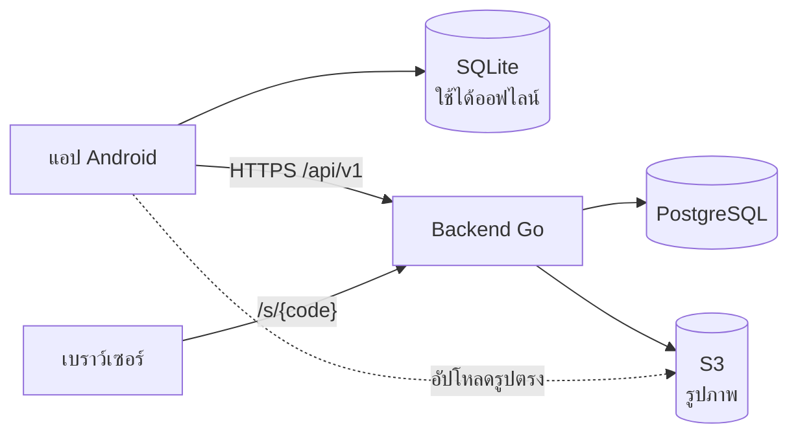
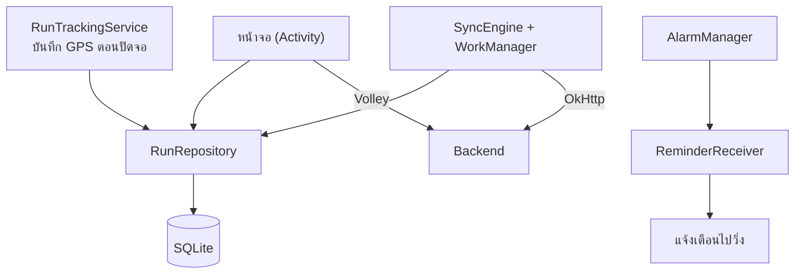

# สถาปัตยกรรมและรายละเอียดทางเทคนิค

[← กลับไปหน้า README](../README.md)

**สารบัญ:** [สถาปัตยกรรม](#สถาปัตยกรรม) · [เทคโนโลยีที่ใช้](#เทคโนโลยีที่ใช้) · [โครงสร้างโปรเจค](#โครงสร้างโปรเจค) · [API โดยสรุป](#api-โดยสรุป) · [สูตรคำนวณและการตรวจการวิ่ง](#สูตรคำนวณและการตรวจการวิ่ง)

---

## สถาปัตยกรรม

### ภาพรวมระบบ



### ภายในแอป



| ส่วน | หน้าที่ |
|---|---|
| `RunRepository` | อ่าน/เขียน SQLite ทั้งหมด เป็นแหล่งข้อมูลหลักของแอป |
| `RunTrackingService` | Foreground service ที่บันทึก GPS ระหว่างวิ่ง แม้ปิดจอหรือออกจากหน้าวิ่ง |
| `SyncEngine` | ส่งและดึงข้อมูลกับเซิร์ฟเวอร์ ทำงานผ่าน WorkManager เมื่อมีเน็ต |
| Volley | คำขอที่หน้าจอรอผล เช่น อันดับ แจ้งเตือน แชร์ เปลี่ยนรหัสผ่าน |
| OkHttp | การซิงก์เบื้องหลัง ซึ่งต้องเรียกแบบรอผลใน WorkManager |

**หลักการสำคัญ**
- **Offline-first:** ทุกอย่างบันทึกลงเครื่องก่อน แล้วค่อยอัปโหลดเมื่อมีเน็ต
- **ส่งซ้ำได้ไม่เกิดข้อมูลซ้ำ:** การวิ่งแต่ละรอบมี UUID ที่สร้างในเครื่อง
- **รูปไม่ผ่าน backend:** มือถืออัปโหลดตรงไป S3 ด้วย presigned URL
- **เซิร์ฟเวอร์ตรวจเอง:** คำนวณระยะใหม่จากจุด GPS ด้วยสูตรเดียวกับแอป ก่อนนับเข้าอันดับ

---

## เทคโนโลยีที่ใช้

### แอป Android

| ส่วน | ที่ใช้ |
|---|---|
| ภาษา / UI | Kotlin · XML Layout + ViewBinding · Material 3 |
| Build | Gradle Kotlin DSL · Version Catalog · AGP 9.3.3 · `minSdk 28` · `targetSdk 37` |
| ฐานข้อมูล | SQLite (`SQLiteOpenHelper`) |
| เครือข่าย | Volley · OkHttp 5 · `org.json` |
| งานเบื้องหลัง | WorkManager · Foreground Service · AlarmManager |
| แผนที่ / ตำแหน่ง | osmdroid (OpenStreetMap) · `LocationManager` |
| เซนเซอร์ | Step Counter · Rotation Vector · Magnetometer · Accelerometer · Barometer · Light · Temperature |
| ความปลอดภัย | เข้ารหัส token ด้วย AES-GCM จาก Android Keystore |
| อื่น ๆ | ZXing (QR) · ExifInterface · กราฟและภาพแชร์วาดด้วย `Canvas` |

### Backend

| ส่วน | ที่ใช้ |
|---|---|
| ภาษา / Framework | Go 1.27 · Fiber v3 |
| ฐานข้อมูล | PostgreSQL 17 · pgx v5 · goose (migration ฝังใน binary) |
| เก็บไฟล์ | S3 API (aws-sdk-go-v2) · RustFS ในเครื่อง · S3 หรือ Cloudflare R2 ตอนขึ้นจริง |
| ความปลอดภัย | argon2id · JWT (HS256) · refresh token แบบหมุนเวียน · rate limit |
| รันระบบ | Docker multi-stage (distroless) · Docker Compose · Makefile |
| ทดสอบ | `go test` + testcontainers (PostgreSQL จริง) · `scripts/smoke.sh` |

---

## โครงสร้างโปรเจค

```
RunTrail/
├── app/src/
│   ├── main/java/com/example/runtrail/
│   │   ├── data/          ฐานข้อมูล SQLite · RunRepository · ค่าตั้ง · ไฟล์สำรอง
│   │   ├── domain/        สูตรคำนวณล้วน (ทดสอบบน JVM ได้)
│   │   ├── net/           Volley · OkHttp · แปลง JSON · เก็บ token
│   │   ├── sync/          SyncEngine · WorkManager
│   │   ├── service/       RunTrackingService
│   │   ├── sensor/        GPS · Step Counter · เข็มทิศ
│   │   ├── reminder/      AlarmManager · BroadcastReceiver
│   │   └── ui/            หน้าจอแยกตามฟีเจอร์ · common · widget
│   ├── main/res/          layout · drawable · values (ไทย) · values-en · values-night
│   ├── test/              unit test
│   └── androidTest/       test บนเครื่อง
├── backend/
│   ├── cmd/api/           จุดเริ่มเซิร์ฟเวอร์
│   └── internal/
│       ├── api/           handler ทุก endpoint + หน้าเว็บแชร์
│       ├── track/         คำนวณระยะ · ตรวจการวิ่ง · ซ่อนจุดรอบบ้าน
│       ├── auth/          รหัสผ่าน · JWT · refresh token
│       ├── db/            PostgreSQL + migrations
│       ├── storage/       S3
│       ├── httpx/         รูปแบบ error · อ่าน JSON
│       └── config/        ค่าจาก env
├── tools/gps-bridge/      ส่ง GPS จาก iPhone เข้า Emulator
└── docs/                  เอกสารและภาพหน้าจอ
```

---

## API โดยสรุป

ทุก endpoint อยู่ใต้ `/api/v1` · 🔒 = ต้องส่ง `Authorization: Bearer <token>` · ฉบับเต็มพร้อมตัวอย่างอยู่ที่ [`backend/README.md`](../backend/README.md)

| กลุ่ม | Endpoint |
|---|---|
| บัญชี | `POST /auth/register` · `/auth/login` · `/auth/refresh` · `/auth/logout` · `/auth/change-password` 🔒 |
| ผู้ใช้ 🔒 | `GET/PATCH/DELETE /me` · `GET /me/stats` · `/me/avatar/*` · `GET /users/{id}/summary` |
| การวิ่ง 🔒 | `PUT /runs/{uuid}` · `PATCH` · `DELETE` · `GET /runs?updated_since=&cursor=` · `GET /runs/{uuid}` · `/track` |
| รูป 🔒 | `POST /runs/{uuid}/photo/upload-url` → อัปโหลดไป S3 → `POST …/photo/confirm` · `DELETE …/photo` |
| แชร์ | `POST/DELETE /runs/{uuid}/share` 🔒 · `GET /public/runs/{code}` · หน้าเว็บ `GET /s/{code}` |
| อันดับ 🔒 | `GET /leaderboard?metric=&period=&scope=` · `GET /leaderboard/me` |
| แจ้งเตือน 🔒 | `GET /notifications` · `POST /notifications/read` |
| ระบบ | `GET /healthz` · `GET /readyz` |

---

## สูตรคำนวณและการตรวจการวิ่ง

### สูตรที่ใช้

| ค่า | วิธีคำนวณ |
|---|---|
| ระยะระหว่าง 2 จุด | Haversine: `d = 2R·asin(√(sin²(Δφ/2) + cosφ₁·cosφ₂·sin²(Δλ/2)))`, R = 6,371 กม. |
| เพซ | `เวลาเคลื่อนที่ ÷ ระยะ (กม.)` หน่วย วินาที/กม. |
| เพซปัจจุบัน | จากระยะและเวลาใน 30 วินาทีล่าสุด |
| แคลอรี่ | `MET × น้ำหนัก (กก.) × ชั่วโมง` โดย `MET = (0.2 × ความเร็ว (ม./นาที) + 3.5) ÷ 3.5` (ACSM) |
| Split | เวลาที่ผ่านแต่ละหลักกิโลเมตร ประมาณเชิงเส้นระหว่างจุด |
| ความสูงสะสม | รวมเฉพาะช่วงขึ้น ไม่นับการแกว่งต่ำกว่า 2 ม. |
| Cadence | ก้าวที่เพิ่มใน 30 วินาทีล่าสุด ÷ เวลา (นาที) |
| สีตามเพซ | เร็ว < 5:50 · คงที่ ≤ 6:15 · ปานกลาง ≤ 6:40 · ช้ากว่านั้น (ต่อ กม.) |
| Best 1 / 5 / 10 กม. | ช่วงที่เร็วที่สุดจริงในเส้นทาง (sliding window บนเซิร์ฟเวอร์) |

### เกณฑ์นับเข้าอันดับ

เซิร์ฟเวอร์นับการวิ่งเมื่อผ่านทุกข้อ ถ้าไม่ผ่านจะยังเก็บไว้ แต่ไม่นับ และแอปบอกเหตุผล

| เกณฑ์ | ค่า |
|---|---|
| จำนวนจุด GPS | อย่างน้อย 30 จุด |
| ระยะห่างของจุด | ไม่เกิน 10 วินาที |
| ระยะต่างจากที่แอปวัด | ไม่เกิน 5% |
| เพซเฉลี่ย | ไม่เร็วกว่า 2:50 / กม. |
| ช่วง 30 วินาทีที่เร็วที่สุด | ไม่เกิน 7 ม./วิ |
| เวลาเริ่ม | ไม่อยู่ในอนาคต |
| แหล่งที่มา | ต้องเป็น GPS (การวิ่งที่เพิ่มเองไม่นับ) |

ระยะในช่วงที่กดหยุดไม่ถูกนับทั้งในแอปและบนเซิร์ฟเวอร์
