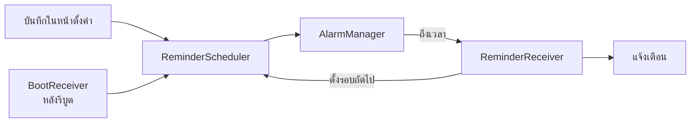

# การนำเนื้อหา MA08–MA13 มาใช้

[← กลับไปหน้า README](../README.md)

แต่ละบทใช้ตรงไหนในแอป พร้อมลิงก์ไปไฟล์โค้ดจริง

**สารบัญ:** [MA08](#ma08-input-controls) · [MA09](#ma09-การเก็บข้อมูลในเครื่อง) · [MA10](#ma10-sqlite--recyclerview) · [MA11](#ma11-ฐานข้อมูลออนไลน์) · [MA12](#ma12-เซนเซอร์) · [MA13](#ma13-scheduler-และการแจ้งเตือน) · [จุดที่ต่างจากสไลด์](#จุดที่ต่างจากตัวอย่างในสไลด์)

| บท | สรุป |
|---|---|
| MA08 | RadioGroup · CheckBox · SwitchCompat · Spinner · AutoCompleteTextView · RatingBar · Date/TimePicker |
| MA09 | SharedPreferences · `openFileOutput` + Properties · SAF ส่งออก/นำเข้า · `onSaveInstanceState` |
| MA10 | SQLiteOpenHelper · CRUD · RecyclerView · กล้อง/แกลเลอรี + EXIF |
| MA11 | Volley (`ApiConfig` · `VolleyApi` · `JsonObjectRequest`) เรียก REST API |
| MA12 | GPS · Step Counter · เข็มทิศ · หน้าตรวจเซนเซอร์ |
| MA13 | AlarmManager · BroadcastReceiver · BootReceiver · Notification |

---

## MA08 Input Controls

| Control | ใช้ทำอะไร | ไฟล์ |
|---|---|---|
| `RadioGroup` + `RadioButton` | เลือกหน่วย ธีม ภาษา (เลือกได้ค่าเดียว) | [`Sheets.kt`](../app/src/main/java/com/example/runtrail/ui/common/Sheets.kt) |
| `CheckBox` | เลือกวันเตือนไปวิ่ง · "ลบจากเซิร์ฟเวอร์ด้วย" | [`dialog_reminder.xml`](../app/src/main/res/layout/dialog_reminder.xml) · [`dialog_delete.xml`](../app/src/main/res/layout/dialog_delete.xml) |
| `SwitchCompat` | เปิด/ปิดการเตือน | [`dialog_reminder.xml`](../app/src/main/res/layout/dialog_reminder.xml) |
| `Spinner` | เรียงลำดับประวัติ (ใช้ layout 2 ตัว) | [`HistoryActivity.kt`](../app/src/main/java/com/example/runtrail/ui/history/HistoryActivity.kt) |
| `AutoCompleteTextView` | พิมพ์ค้นหาประเทศ (`setThreshold(1)`) | [`CountryPicker.kt`](../app/src/main/java/com/example/runtrail/ui/common/CountryPicker.kt) |
| `RatingBar` | ให้คะแนนความรู้สึกหลังวิ่ง | [`AddEditRunActivity.kt`](../app/src/main/java/com/example/runtrail/ui/edit/AddEditRunActivity.kt) |
| `DatePickerDialog` / `TimePickerDialog` | เลือกวันเวลาวิ่งย้อนหลัง · เวลาเตือน | [`AddEditRunActivity.kt`](../app/src/main/java/com/example/runtrail/ui/edit/AddEditRunActivity.kt) · [`SettingsActivity.kt`](../app/src/main/java/com/example/runtrail/ui/settings/SettingsActivity.kt) |
| `EditText` | ทุกฟอร์ม (ชื่อ โน้ต ระยะ เวลา อีเมล รหัสผ่าน) | หน้า Login · Register · Add/Edit |

## MA09 การเก็บข้อมูลในเครื่อง

| วิธี | ใช้ทำอะไร | ไฟล์ |
|---|---|---|
| SharedPreferences | โปรไฟล์ ค่าตั้ง เวลาเตือน | [`PrefsHelper.kt`](../app/src/main/java/com/example/runtrail/data/PrefsHelper.kt) |
| App-specific Storage | `openFileOutput` + `Properties` จำการส่งออก/นำเข้าครั้งล่าสุด | [`BackupInfo.kt`](../app/src/main/java/com/example/runtrail/data/BackupInfo.kt) |
| SAF | `CreateDocument` ส่งออก / `OpenDocument` นำเข้าประวัติเป็น JSON | [`SettingsActivity.kt`](../app/src/main/java/com/example/runtrail/ui/settings/SettingsActivity.kt) · [`RunBackup.kt`](../app/src/main/java/com/example/runtrail/data/RunBackup.kt) |
| Save Instance State | ค่าบนหน้าจอไม่หายตอน Activity ถูกสร้างใหม่ | ทุกหน้าที่มีสถานะ เช่น [`AddEditRunActivity.kt`](../app/src/main/java/com/example/runtrail/ui/edit/AddEditRunActivity.kt) |

## MA10 SQLite + RecyclerView

| ส่วน | รายละเอียด | ไฟล์ |
|---|---|---|
| ฐานข้อมูล | `SQLiteOpenHelper` 3 ตาราง (runs · run_points · splits) และ `onUpgrade` ไป v2 | [`RunDb.kt`](../app/src/main/java/com/example/runtrail/data/RunDb.kt) |
| CRUD | insert · query · update · delete ด้วย `ContentValues` และ `Cursor` | [`RunRepository.kt`](../app/src/main/java/com/example/runtrail/data/RunRepository.kt) |
| RecyclerView | ประวัติ (จัดกลุ่มรายเดือน) · อันดับ · การแจ้งเตือน | [`RunAdapter.kt`](../app/src/main/java/com/example/runtrail/ui/history/RunAdapter.kt) |
| รูปภาพ | กล้อง/แกลเลอรี → แก้ทิศตาม EXIF → ย่อ → JPEG | [`ImageStore.kt`](../app/src/main/java/com/example/runtrail/ui/common/ImageStore.kt) |
| ส่งผลกลับ | หน้าแก้ไขส่ง `setResult(RESULT_OK)` กลับหน้ารายละเอียด | [`RunDetailActivity.kt`](../app/src/main/java/com/example/runtrail/ui/detail/RunDetailActivity.kt) |

## MA11 ฐานข้อมูลออนไลน์

แอปไม่ต่อฐานข้อมูลตรง แต่เรียก REST API ของ backend แล้วรับ JSON กลับมา

| ส่วน | รายละเอียด | ไฟล์ |
|---|---|---|
| `ApiConfig` | รวม URL ของทุก endpoint ไว้ที่เดียว | [`ApiConfig.kt`](../app/src/main/java/com/example/runtrail/net/ApiConfig.kt) |
| `VolleyApi` | `RequestQueue` ตัวเดียวทั้งแอป · `JsonObjectRequest` 5 พารามิเตอร์ | [`VolleyApi.kt`](../app/src/main/java/com/example/runtrail/net/VolleyApi.kt) |
| GET | อันดับโลก · สรุปนักวิ่ง · การแจ้งเตือน | [`LeaderboardActivity.kt`](../app/src/main/java/com/example/runtrail/ui/leaderboard/LeaderboardActivity.kt) |
| POST / PATCH / DELETE | เปลี่ยนรหัสผ่าน · ตั้งประเทศ · สร้าง/ยกเลิกลิงก์แชร์ | [`SettingsActivity.kt`](../app/src/main/java/com/example/runtrail/ui/settings/SettingsActivity.kt) · [`ShareSheet.kt`](../app/src/main/java/com/example/runtrail/ui/share/ShareSheet.kt) |
| ซิงก์เบื้องหลัง | ใช้ OkHttp เพราะ WorkManager ต้องเรียกแบบรอผล | [`ApiClient.kt`](../app/src/main/java/com/example/runtrail/net/ApiClient.kt) |

## MA12 เซนเซอร์

| เซนเซอร์ | ใช้ทำอะไร | ไฟล์ |
|---|---|---|
| GPS | บันทึกเส้นทางทุก 1 วินาที | [`LocationTracker.kt`](../app/src/main/java/com/example/runtrail/sensor/LocationTracker.kt) |
| Step Counter | คำนวณ Cadence (ก้าว/นาที) | [`CadenceTracker.kt`](../app/src/main/java/com/example/runtrail/sensor/CadenceTracker.kt) |
| Rotation Vector / Magnetometer | เข็มทิศบนหน้าวิ่ง | [`CompassHelper.kt`](../app/src/main/java/com/example/runtrail/sensor/CompassHelper.kt) |
| ทุกตัว | ตรวจว่ามีหรือไม่ + ค่าสด · register ใน `onResume` / unregister ใน `onPause` | [`SensorCheckActivity.kt`](../app/src/main/java/com/example/runtrail/ui/sensor/SensorCheckActivity.kt) |

## MA13 Scheduler และการแจ้งเตือน

| ส่วน | รายละเอียด | ไฟล์ |
|---|---|---|
| ตั้งเวลา | `setExactAndAllowWhileIdle(RTC_WAKEUP)` · ตรวจ `canScheduleExactAlarms()` | [`ReminderScheduler.kt`](../app/src/main/java/com/example/runtrail/reminder/ReminderScheduler.kt) |
| รับเมื่อถึงเวลา | แสดงแจ้งเตือน แล้วตั้งรอบถัดไป | [`ReminderReceiver.kt`](../app/src/main/java/com/example/runtrail/reminder/ReminderReceiver.kt) |
| หลังรีบูต | รับ `BOOT_COMPLETED` แล้วตั้งเวลากลับ | [`BootReceiver.kt`](../app/src/main/java/com/example/runtrail/reminder/BootReceiver.kt) |
| แจ้งเตือน | Notification Channel · `PendingIntent` เปิดแอป | [`ReminderNotifier.kt`](../app/src/main/java/com/example/runtrail/reminder/ReminderNotifier.kt) |
| ประกาศ | permission และ receiver ทั้งสองตัว | [`AndroidManifest.xml`](../app/src/main/AndroidManifest.xml) |

---

## จุดที่ต่างจากตัวอย่างในสไลด์

| ในสไลด์ | ในโปรเจค | เหตุผล |
|---|---|---|
| Java | Kotlin | ใช้ Android API ชุดเดียวกัน |
| PHP + MySQL | Go + PostgreSQL | หลักการเดียวกัน: แอป → HTTP → เซิร์ฟเวอร์ → ฐานข้อมูล → JSON |
| รูปเป็น Base64 ใน SQLite / JSON | เก็บเป็นไฟล์ และอัปโหลดตรงไป S3 | แถวที่ใหญ่เกิน ~2 MB อ่านจาก SQLite ไม่ได้ และ Base64 ทำให้ข้อมูลใหญ่ขึ้น ~33% |
| `usesCleartextTraffic="true"` | `network_security_config` เฉพาะ build debug | build ที่ใช้จริงต้องเป็น HTTPS |
| `BASE_URL` เป็นค่าคงที่ | อ่านค่าตอนรัน | ผู้ใช้เปลี่ยนที่อยู่เซิร์ฟเวอร์ได้ |
