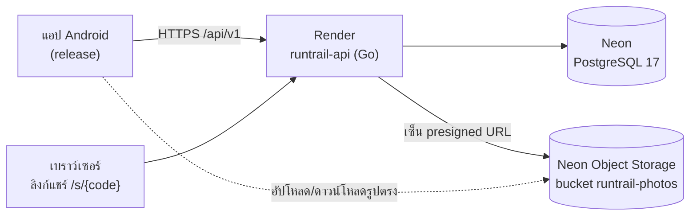

# Deploy ฟรี: Render + Neon

[← กลับไปหน้า README](../README.md)

ระบบจริงที่ใช้งานอยู่ ไม่เสียเงินและไม่ต้องผูกบัตร

| ส่วน | ใช้ | แทนของเดิมในเครื่อง (Docker) |
|---|---|---|
| Backend (Go, Docker) | **Render**: Web Service แพ็กเกจ Free | container `api` |
| ฐานข้อมูล | **Neon**: PostgreSQL 17 แพ็กเกจ Free | container `db` |
| ที่เก็บรูป | **Neon Object Storage** (S3 API) ในโปรเจค Neon เดียวกัน | container `s3` (RustFS) |

**สถานะ:** deploy แล้วที่ **<https://runtrail-api.onrender.com>** · `make deploy-check` ผ่าน 29/29 ·
end-to-end test ฝั่งแอปผ่านกับเซิร์ฟเวอร์จริง · แอป release ต่อเซิร์ฟเวอร์นี้เป็นค่าเริ่มต้น



ทุกส่วนอยู่ภูมิภาค **Singapore** (Render `singapore` · Neon `aws-ap-southeast-1`)

---

## 0. ข้อจำกัดของแพ็กเกจฟรี

| เจ้า | ข้อจำกัด | ผลกับแอป |
|---|---|---|
| Render | หลับเมื่อไม่มีคนเรียก 15 นาที ปลุกใช้ ~1 นาที · RAM 512 MB · CPU 0.1 · 750 ชม./เดือน (รวมทุก service ฟรีในบัญชี) | แอปปลุกเซิร์ฟเวอร์ล่วงหน้า รอได้ 90 วินาที และแจ้ง "เซิร์ฟเวอร์กำลังตื่น" · ลิงก์แชร์ที่เปิดครั้งแรกจะช้า |
| Neon Postgres | 1 GB · compute พักเองเมื่อว่าง | เกินพอสำหรับงานนี้ |
| Neon Object Storage | 5 GB ต่อโปรเจค | รูปละ ≤ 1280 px (~200 KB) → ราว 25,000 รูป |
| Neon (รวม) | ข้อมูลออก 5 GB/เดือน ใช้ร่วมกันทั้งฐานข้อมูลและรูป | ถ้าเกิน Neon หยุด compute ถึงรอบเดือนถัดไป (ไม่เก็บเงิน ข้อมูลไม่หาย) |

ไม่มีบัตร = ไม่มีทางถูกเก็บเงิน ใช้เกินโควตาแค่หยุดชั่วคราว
**ห้ามใช้ Postgres ฟรีของ Render** เพราะถูกลบพร้อมข้อมูลหลัง 30 วัน

---

## 1. Neon: ฐานข้อมูล + ที่เก็บรูป

### หน้าเว็บ
1. <https://neon.com> → **New project** → ชื่อ `runtrail` · Region **AWS Asia Pacific 1 (Singapore)** · Postgres 17
2. Services: เปิด **Postgres database** (ที่เหลือปิดได้)

### ด้วย Neon CLI (สร้าง bucket และดึงกุญแจ)
```bash
npm i -g neon
neon login                                    # เปิดเบราว์เซอร์ให้ล็อกอิน
neon link --project-id <PROJECT_ID> -y        # ผูกโฟลเดอร์นี้กับโปรเจค · ดึง env ลง .env.local (git-ignored)
neon bucket create runtrail-photos --branch production   # bucket แบบ private
neon env pull                                 # เพิ่ม AWS_* ของ Object Storage ลง .env.local
```

`.env.local` จะมีค่าที่ต้องใช้ใน Render:

| ใน `.env.local` | ใส่ใน Render เป็น | หน้าตา |
|---|---|---|
| `DATABASE_URL_UNPOOLED` | `DATABASE_URL` | `postgresql://…@ep-….ap-southeast-1.aws.neon.tech/neondb?sslmode=require` (ไม่มี `-pooler`) |
| `AWS_ENDPOINT_URL_S3` | `S3_ENDPOINT` | `https://br-….storage.c-4.ap-southeast-1.aws.neon.tech` |
| `AWS_ACCESS_KEY_ID` | `S3_ACCESS_KEY` | ขึ้นต้น `nak_live_` (41 ตัว) |
| `AWS_SECRET_ACCESS_KEY` | `S3_SECRET_KEY` | 73 ตัว |

คัดลอกเฉพาะค่าหลัง `=` ไม่เอาเครื่องหมาย `"` · ตารางในฐานข้อมูลสร้างเองตอน backend เริ่ม (migration ฝังอยู่ใน binary)

> [!TIP]
> คัดลอกค่าเข้าคลิปบอร์ดโดยไม่ต้องลากเลือก (macOS):
> ```bash
> grep '^AWS_SECRET_ACCESS_KEY=' .env.local | cut -d= -f2- | tr -d '"\n' | pbcopy
> ```

---

## 2. Render: backend (Blueprint)

1. <https://render.com> → สมัครด้วย GitHub และให้สิทธิ์ repo `RunTrail`
2. **+ New → Blueprint** → เลือก repo → Blueprint Name `runtrail` · Branch `main`
3. Render อ่าน [`render.yaml`](../render.yaml) แล้วถามค่าลับ 4 ช่องตามตารางในข้อ 1
4. **Deploy Blueprint** → service `runtrail-api` → แท็บ **Logs** ต้องเห็น `"database ready"` และ `"listening"` → สถานะ **Live**

ค่าที่ `render.yaml` ตั้งให้แล้ว: Docker (`backend/Dockerfile`) · Free · Singapore · health check `/healthz` ·
`PUBLIC_BASE_URL=https://runtrail-api.onrender.com` · `S3_REGION=ap-southeast-1` · `S3_BUCKET=runtrail-photos` ·
`S3_PATH_STYLE=true` · `S3_CREATE_BUCKET=false` · `PROXY_HEADER=X-Forwarded-For` · `LOG_LEVEL=info` ·
`JWT_SECRET` (Render สุ่มให้) · `PORT` (Render ใส่เอง)

- ถ้าได้ URL อื่น (ชื่อซ้ำ) → แก้ `PUBLIC_BASE_URL` ในหน้า Environment และ build แอปด้วย `-PreleaseApiUrl=<URL>`
- ค่า `sync: false` ถูกถามแค่ครั้งแรก แก้ภายหลังที่ **runtrail-api → Environment → Save Changes**
- push เข้า `main` แล้วมีไฟล์ใน `backend/` เปลี่ยน → Render deploy ใหม่เอง

---

## 3. ตรวจหลัง deploy

```bash
cd backend
make deploy-check URL=https://runtrail-api.onrender.com
# ปลุกเซิร์ฟเวอร์ (รอได้ 2 นาที) → {"db":"ok","storage":"ok"} → smoke test → ALL 29 CHECKS PASSED
```

smoke test สร้างบัญชีทดสอบ `smoke…@example.com` ทิ้งไว้ (การวิ่งของบัญชีนั้นถูกลบตอนจบ)

| `/readyz` ตอบ | สาเหตุ / วิธีแก้ |
|---|---|
| db ไม่ ok | `DATABASE_URL` ผิด · มี `"` ติดมา · ต้องเป็นแบบ direct (ไม่มี `-pooler`) และมี `sslmode=require` |
| `Custom endpoint … was not a valid URI` | วางค่าผิดช่อง: `S3_ENDPOINT` ต้องเป็น URL `https://br-…neon.tech` |
| `HeadObject … 403 Forbidden` | `S3_ACCESS_KEY` / `S3_SECRET_KEY` ไม่ตรงคู่กัน (สลับช่องหรือมีอักษรติดมา) → วางใหม่ทั้งคู่ |
| `SignatureDoesNotMatch` | `S3_REGION` ต้องเป็น `ap-southeast-1` และ `S3_PATH_STYLE=true` |
| ลิงก์แชร์ชี้ผิดที่ | `PUBLIC_BASE_URL` ต้องตรง URL ของ Render |

---

## 4. แอป

- **APK พร้อมใช้:** `./gradlew assembleRelease` ชี้ `https://runtrail-api.onrender.com` และเซ็นด้วย release key
  (ตั้งค่า signing ที่ [SETUP.md](SETUP.md#build-apk-สำหรับติดตั้งจริง))
- **debug build** ยังชี้ Emulator (`http://10.0.2.2:8080`) ถ้าจะใช้กับเซิร์ฟเวอร์จริง: หน้าเข้าสู่ระบบ → **เซิร์ฟเวอร์** → `https://runtrail-api.onrender.com`
- ถ้าแอปล็อกอินกับเซิร์ฟเวอร์อื่นอยู่ แอปจะไม่ยอมเปลี่ยนเซิร์ฟเวอร์จนกว่าจะออกจากระบบ (กันข้อมูลซิงก์ผิดที่):
  ซิงก์ให้ครบ → ออกจากระบบ → เปลี่ยนเซิร์ฟเวอร์ → สมัคร/ล็อกอิน

---

## 5. ดูแลระบบ

- **สำรองข้อมูล** (`brew install libpq` ครั้งแรก เพื่อให้มี `pg_dump`):
  ```bash
  pg_dump "<DATABASE_URL>" --format=custom --file=runtrail_$(date +%F).dump
  pg_restore --clean --if-exists -d "<DATABASE_URL>" runtrail_YYYY-MM-DD.dump   # คืนข้อมูล
  ```
  รูปไม่ได้อยู่ใน dump · ดูรายการรูป: `neon bucket object list runtrail-photos --branch production`
- **Log:** Render → `runtrail-api` → Logs (JSON) · Neon storage: `neon logs query --branch production --source storage --since 1h`
- **งานลบรูปที่อัปโหลดค้าง** รันทุกชั่วโมงเฉพาะตอนเซิร์ฟเวอร์ตื่น
- **เปลี่ยนความลับ:** เปลี่ยน `JWT_SECRET` = ทุกเครื่องต้องล็อกอินใหม่ · หมุนกุญแจรูป: `neon credentials rotate <tokenId>` แล้วแก้ `S3_ACCESS_KEY` / `S3_SECRET_KEY`
- **Rate limit:** `PROXY_HEADER=X-Forwarded-For` ทำให้นับแยกตาม IP จริงของผู้ใช้ เซิร์ฟเวอร์เชื่อ header นี้เฉพาะเมื่อคำขอมาจาก proxy ใน private network (Render) และใช้ IP ขวาสุดที่ proxy เติม ผู้ใช้จึงปลอม IP เพื่อหลบ limit ไม่ได้

---

## 6. Checklist

- [x] Neon: โปรเจค `runtrail` Singapore · Postgres 17 · bucket `runtrail-photos` (private)
- [x] Render: Blueprint → ใส่ 4 ค่า → Live ที่ `runtrail-api.onrender.com`
- [x] `make deploy-check URL=https://runtrail-api.onrender.com` → 29/29
- [x] แอป release ต่อเซิร์ฟเวอร์จริง: สมัคร → วิ่ง → ซิงก์ → รูป → แชร์ลิงก์ → อันดับ
- [ ] ตั้งเตือนตัวเองให้ `pg_dump` เป็นระยะ

## อ้างอิง

- Render: [Free instances](https://render.com/docs/free) · [Blueprint YAML reference](https://render.com/docs/blueprint-spec)
- Neon: [Pricing / Free plan](https://neon.com/pricing) · [Object Storage](https://neon.com/docs/storage/overview) · [S3 compatibility](https://neon.com/docs/storage/s3-compatibility) · [CLI](https://neon.com/docs/cli/install)
