# ฟีเจอร์และภาพหน้าจอ

[← กลับไปหน้า README](../README.md)

รายละเอียดทุกฟีเจอร์ของแอป และภาพหน้าจอทั้งหมด

- [ภาพหน้าจอ](#ภาพหน้าจอ)
- [ฟีเจอร์](#ฟีเจอร์)

---

## ภาพหน้าจอ

> ถ่ายจาก Android Emulator (Pixel 9 / 9a, Android 17) เชื่อมกับ backend จริงที่รันใน Docker

**เริ่มต้นใช้งาน**

| Welcome | ขอสิทธิ์ | เข้าสู่ระบบ | สมัครสมาชิก | โปรไฟล์และเป้าหมาย |
|:---:|:---:|:---:|:---:|:---:|
| 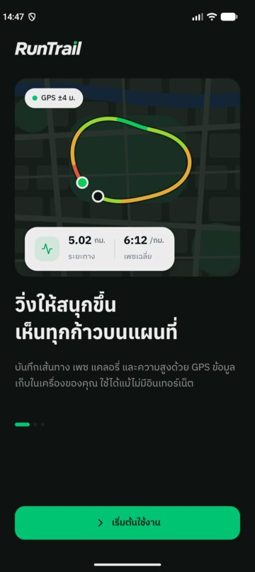 | 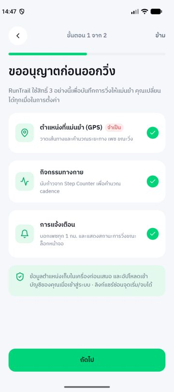 | 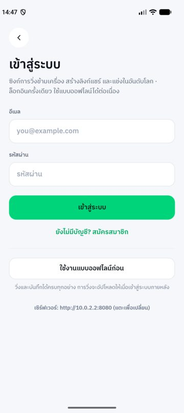 | 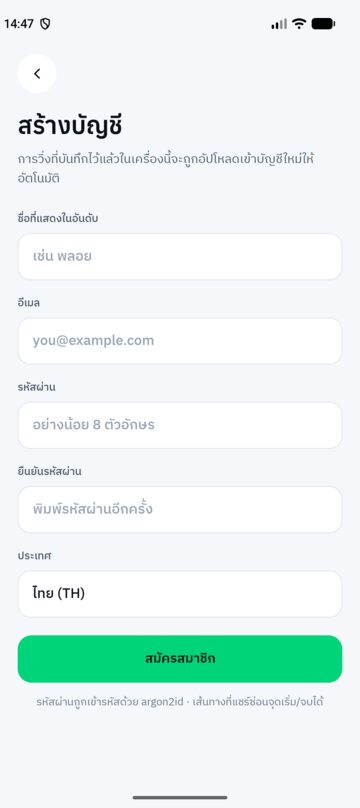 | 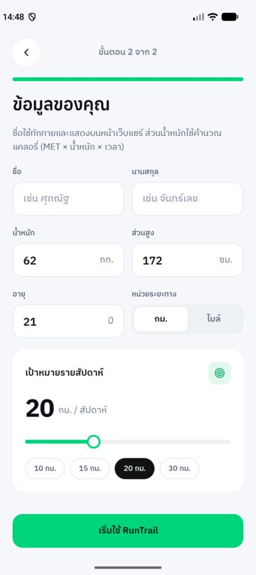 |

**วิ่งและดูผล**

| หน้าหลัก | วิ่งสด (GPS จริง) | หยุดชั่วคราว | สรุปผล | กราฟและ Splits |
|:---:|:---:|:---:|:---:|:---:|
| 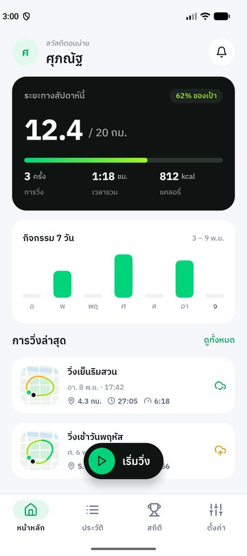 | 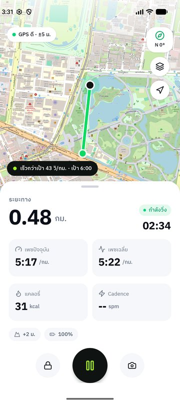 | 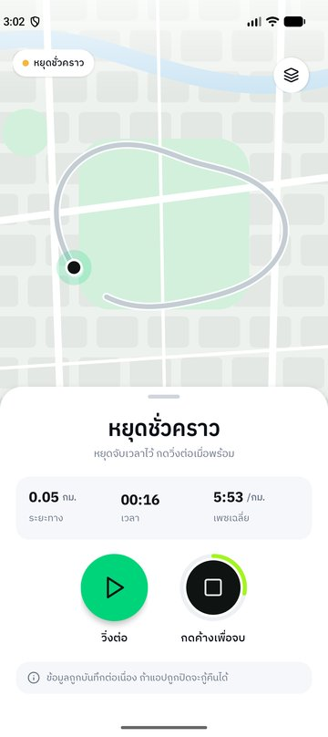 | 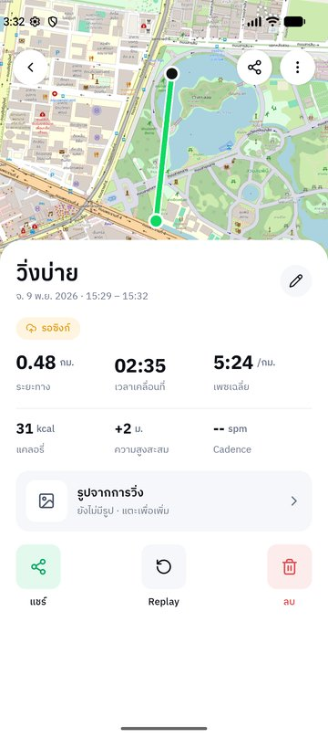 | 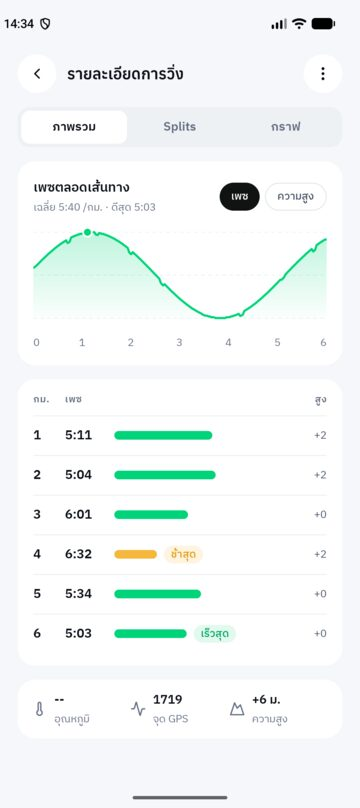 |

**แชร์และเปรียบเทียบ**

| แชร์และซิงก์ | ภาพแชร์ | หน้าเว็บแชร์ | อันดับโลก | การแจ้งเตือน |
|:---:|:---:|:---:|:---:|:---:|
| 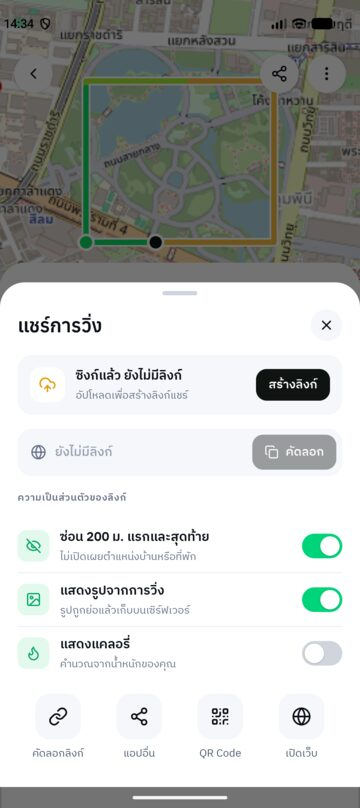 | 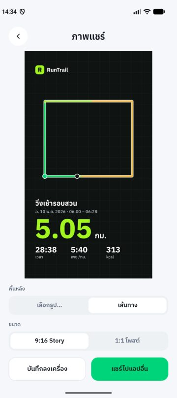 | 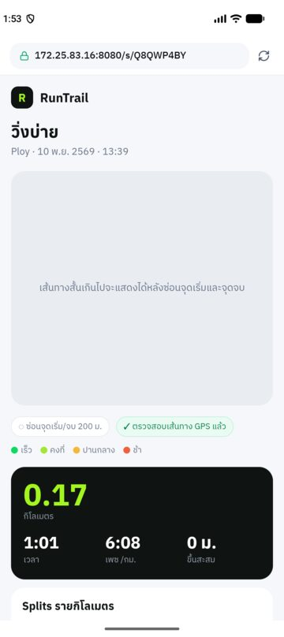 | 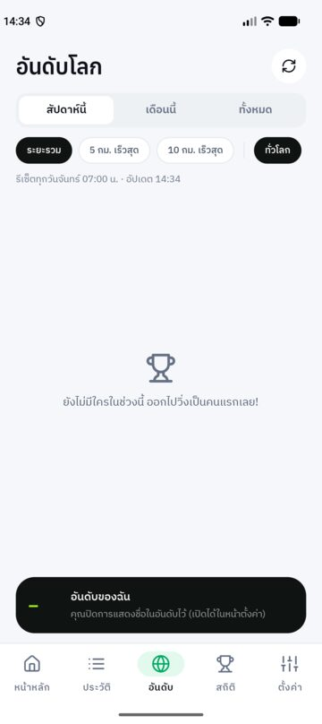 | 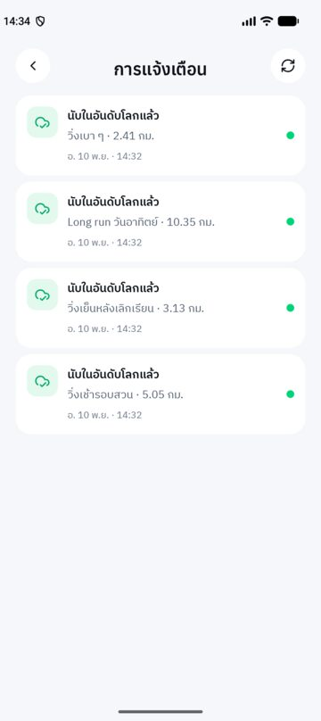 |

<b>ดูหน้าจออื่น ๆ ทั้งหมด</b>

| Replay | แก้ไขการวิ่ง | ประวัติ | สถิติส่วนตัว | ตั้งค่า |
|:---:|:---:|:---:|:---:|:---:|
| 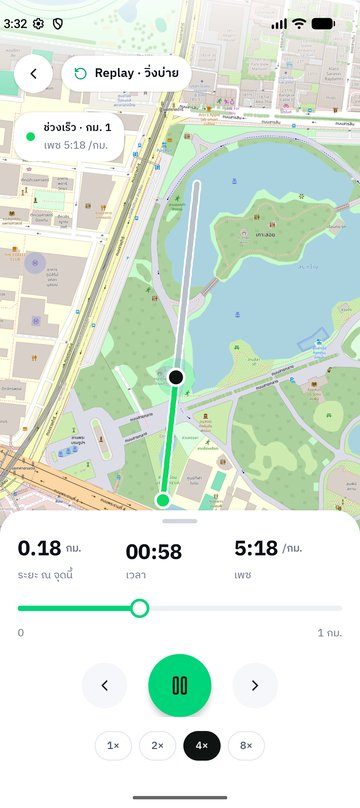 | 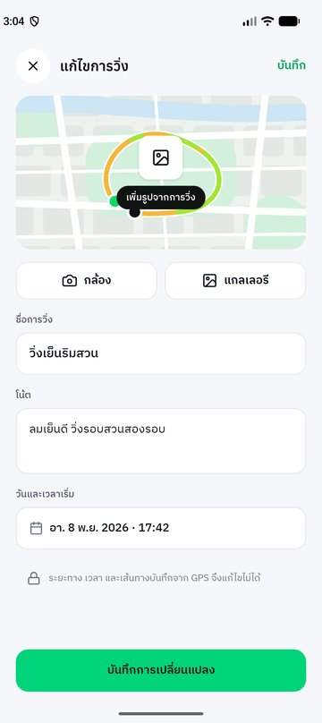 | 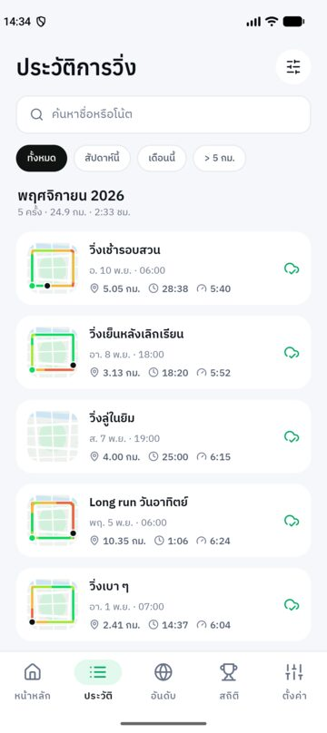 | 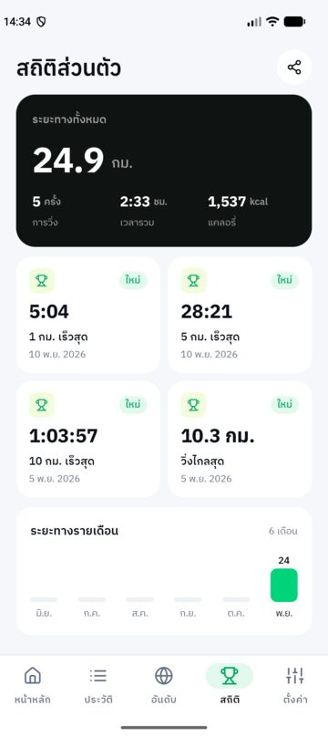 | 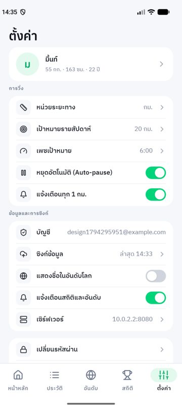 |

| กู้การวิ่งที่ค้าง | ยืนยันการลบ | ตัวเลือก (Bottom sheet) |
|:---:|:---:|:---:|
| 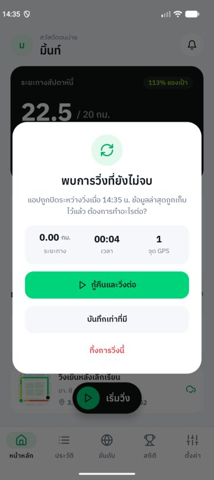 | 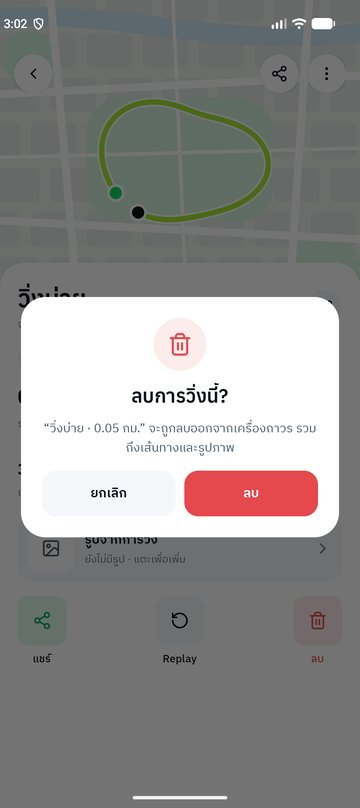 | 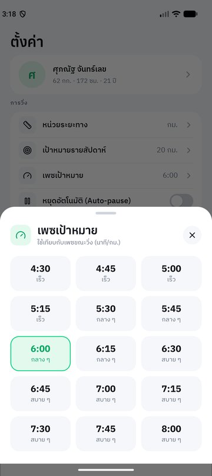 |

---

## ฟีเจอร์

### 🏃 บันทึกการวิ่ง
- อ่านตำแหน่งจาก GPS ทุก 1 วินาที ลดการสั่นด้วย Kalman filter ที่ปรับตามความเร็ว และกรองจุดคลาดเคลื่อน (ความแม่นยำแย่กว่า 25 ม. · เร็วเกิน 9 ม./วิ · ขยับน้อยกว่าค่าคลาดเคลื่อน)
- หมุดบนแผนที่ตามตำแหน่งล่าสุดทุกวินาที พร้อมวงความแม่นยำของ GPS
- **Foreground service** — ปิดจอ สลับแอป หรือออกจากหน้าวิ่ง GPS และเวลายังเดินต่อ พร้อมการแจ้งเตือนค้างที่กดหยุด/วิ่งต่อได้
- ระยะ เวลา เพซปัจจุบัน (30 วินาทีล่าสุด) เพซเฉลี่ย แคลอรี่ Cadence ความสูงสะสม แบตเตอรี่ และป้ายเทียบเพซเป้าหมาย
- เส้นทางไล่สีตามเพซบนแผนที่ OpenStreetMap · โหมดแผนที่มืด · ปุ่มกลับตำแหน่งปัจจุบัน · เข็มทิศ
- **Auto-pause** เมื่อหยุดนิ่งเกิน 8 วินาที และวิ่งต่อเองเมื่อเริ่มเคลื่อนที่ · ช่วงที่หยุดไม่นับระยะ
- แจ้งเตือนทุก 1 กม. พร้อมเพซของกิโลนั้น
- **กดค้าง 1.5 วินาทีเพื่อจบ** · ล็อกปุ่ม · ถ่ายรูปเต็มความละเอียดแนบกับการวิ่ง
- **กู้การวิ่งที่ค้าง** — เขียนจุด GPS ลง SQLite ทุก 5 วินาที ถ้าแอปถูกปิดกลางคันจะกู้คืนได้ครบทุกจุด

### 📈 วิเคราะห์ผล
- สรุปผลหลังวิ่ง · ป้าย "สถิติใหม่" · สถานะซิงก์และสถานะในอันดับ (แตะเพื่อดูเหตุผล)
- Splits รายกิโลเมตร · กราฟเพซและความสูง · **Replay** ย้อนการวิ่งบนแผนที่ (1×–8×)
- สถิติส่วนตัว: ระยะ/เวลา/แคลอรี่รวม · 1 / 5 / 10 กม. เร็วสุด · วิ่งไกลสุด · กราฟรายเดือน

### 🗂 จัดการข้อมูล
- ประวัติแบบ RecyclerView จัดกลุ่มรายเดือน · ค้นหา · กรอง · เรียงลำดับ
- เพิ่มการวิ่งย้อนหลัง (บันทึกเอง ไม่นับเข้าอันดับ) · แก้ชื่อ โน้ต และรูป · **ลบรูปออก** (ลบบนเซิร์ฟเวอร์ให้ด้วย) · ลบการวิ่ง (เลือกลบจากเซิร์ฟเวอร์ด้วยได้)

### ☁️ บัญชีและการซิงก์
- สมัคร / เข้าสู่ระบบ / **ใช้งานแบบออฟไลน์ก่อน (Guest)** แล้วล็อกอินทีหลัง การวิ่งเดิมจะถูกผูกบัญชีและอัปโหลดให้
- ซิงก์อัตโนมัติเมื่อมีเน็ต · ล็อกอินเครื่องใหม่ดึงประวัติคืนครบพร้อมเส้นทางและรูป
- เปลี่ยนรหัสผ่าน · ออกจากระบบ (เตือนถ้ายังมีรายการไม่ได้ซิงก์) · ลบบัญชี

### 🔗 แชร์
- **ลิงก์แชร์จริง** เปิดดูได้ในเบราว์เซอร์ (แผนที่ Leaflet + เส้นทางไล่สี + OG tag ให้พรีวิวใน LINE/Facebook)
- ตัวเลือกความเป็นส่วนตัว: **ซ่อน 200 ม. แรกและสุดท้าย** (ตัดที่เซิร์ฟเวอร์) · แสดงรูป · แสดงแคลอรี่
- คัดลอกลิงก์ · ส่งต่อแอปอื่น · QR Code · ยกเลิกลิงก์
- **ภาพแชร์** — สร้างภาพสรุปในเครื่อง (ไม่ต้องใช้เน็ต) พื้นหลังเป็นรูปจากการวิ่งหรือเส้นทาง ขนาด 9:16 (Story) / 1:1 (โพสต์) บันทึกลงแกลเลอรีหรือแชร์ต่อ

### 🏆 อันดับโลกและการแจ้งเตือน
- อันดับ ระยะรวม / 5 กม. เร็วสุด / 10 กม. เร็วสุด · สัปดาห์นี้ / เดือนนี้ / ทั้งหมด · ทั่วโลก / ประเทศของฉัน (ตั้ง/เปลี่ยนประเทศได้ในหน้าตั้งค่าหรือจากหน้าอันดับ)
- นับเฉพาะการวิ่ง GPS ที่เซิร์ฟเวอร์ตรวจแล้ว · แตะรายชื่อเพื่อดูสรุปของนักวิ่งคนนั้น · ปิดการแสดงชื่อได้
- **ศูนย์แจ้งเตือน** จากเหตุการณ์จริง: นับในอันดับแล้ว/ไม่นับ (บอกเหตุผล) · สถิติใหม่ · ถึงเป้าสัปดาห์ · มีคนแซงในอันดับ · มีคนเปิดดูลิงก์แชร์

### ⚙️ ตั้งค่าและอื่น ๆ
- Onboarding: แนะนำแอป → ขอสิทธิ์พร้อมเหตุผล → เข้าสู่ระบบ/Guest → โปรไฟล์และเป้าหมายรายสัปดาห์
- หน่วย กม./ไมล์ (เป้าหมายรายสัปดาห์เก็บเป็น กม. เหมือนเซิร์ฟเวอร์ โหมดไมล์แค่แปลงเพื่อแสดง) · เป้าหมายรายสัปดาห์ · เพซเป้าหมาย · Auto-pause · แจ้งเตือนทุก 1 กม. · แจ้งเตือนสถิติและอันดับ · ที่อยู่เซิร์ฟเวอร์
- ตรวจเซนเซอร์ของเครื่อง (แตะแถวที่ขาดสิทธิ์เพื่อขอสิทธิ์ / เปิดตั้งค่า GPS ได้ทันที) · ล็อกแนวตั้งทุกหน้า
- เปลี่ยนที่อยู่เซิร์ฟเวอร์ได้ตลอด · ถ้าล็อกอินอยู่ แอปจะตรวจก่อนว่าที่อยู่ใหม่เป็นเซิร์ฟเวอร์เดิมของบัญชีนี้ (เช่น IP ของเครื่องเปลี่ยน) จึงใช้ข้อมูลและการซิงก์ต่อได้ทันที · ถ้าเป็นเซิร์ฟเวอร์อื่นต้องซิงก์และออกจากระบบก่อน
